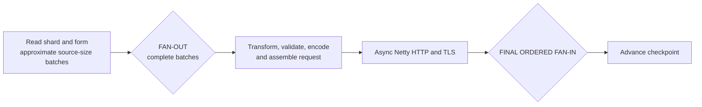
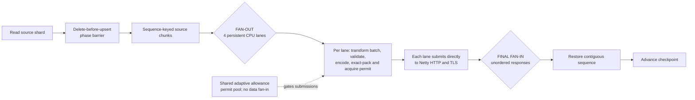

# RFS 3.4.0 versus the November 2026 direct-lane stack

## Conclusion

The final direct-lane RFS topology preserved full migration correctness and
completed within 0.38% of RFS 3.4.0 in the same-target comparison.
Normalized by the time that workers actually held shard leases, its document
rate was 2.15% lower; slightly higher fleet occupancy offset most of that
difference in the end-to-end result.

Both implementations migrated all 2.2B documents and 40 primary
shards. Neither left a failed-document object, caused a target write rejection
or breaker trip, or left the target unhealthy.

A separate constrained-target comparison shows why the additional traffic
control matters even though its well-provisioned performance cost is small.
The November 2026 direct-lane stack completed the same 2.2B-document migration
without a failed document. At the latest observation, RFS 3.4.0 was still
running with only 7 of 40 shards complete and had written 6.84 million unique
document IDs to its failed-document stream.

## Results

CloudWatch Logs retain the work-coordination events with millisecond
timestamps. The primary duration begins when the first data-shard work item was
acquired and ends when the last data-shard work item was marked complete.
Both runs occurred on November 8, 2026.

| Measurement | A — RFS 3.4.0 | E — current direct lanes | Observed difference |
|---|---:|---:|---:|
| First shard acquired, UTC | 07:44:10.064 | 02:57:33.293 | — |
| All 24 initial shards acquired, UTC | 07:44:21.143 | 02:57:39.761 | — |
| Last shard completed, UTC | 08:33:00.241 | 03:46:34.636 | — |
| First acquisition through completion | 48m50.177s | 49m01.343s | E was 11.166s slower; +0.38% duration |
| Effective full-run rate | 750,808 docs/s | 747,958 docs/s | E was 0.38% lower |
| All initial shards active through completion | 48m39.098s | 48m54.875s | E was 15.777s slower; +0.54% duration |

The effective full-run rate is aggregate fleet throughput: 2.2 billion
documents divided by the first-acquisition-through-completion wall time. It is
not a per-worker rate. It includes idle fleet capacity as the 40 shards pass
through 24 workers: at most 16 workers can enter the second wave, and
concurrency declines further during the final shard tail.

The shard acquisition and completion events also allow the occupied time for
all 40 shard leases to be summed:

| Fleet-utilization measure | A — RFS 3.4.0 | E — current direct lanes | Observed difference |
|---|---:|---:|---:|
| Average workers holding a shard lease | 19.82 of 24 | 20.18 of 24 | E averaged 0.36 more active workers |
| Shard-lease utilization | 82.57% | 84.07% | E was 1.50 percentage points higher |
| Documents per active-worker-second | 37,888 | 37,073 | E was 2.15% lower |

“Active” means that a worker held a shard lease. The interval includes shard
download, document processing, HTTP waits and completion; it is not a CPU
utilization measurement. Fleet wall-clock throughput remains the
operator-facing completion measure, while documents per active-worker-second
is the more useful diagnostic for worker-level regression.

The first-acquisition comparison is the primary result. The
all-initial-shards-active boundary corroborates it and produces the same
conclusion: the current pipeline was within approximately one-half percent of
3.4.0.

Deployment creation is intentionally excluded from the performance result.
The current Deployment was accepted at 02:56:48.689 UTC, while the 3.4.0
Deployment was accepted at 07:41:52.672 UTC. The difference between Deployment
creation and first shard acquisition includes pod scheduling, image
availability and process startup rather than migration throughput.

## Code identities

- RFS 3.4.0 used the public
  [`3.4.0` release](https://github.com/opensearch-project/opensearch-migrations/releases/tag/3.4.0).
- The current-code run used
  [`ae3eea93c5117233722eb3c4dfe4a64c7c5e8cc3`](https://github.com/gregschohn/opensearch-migrations/commit/ae3eea93c5117233722eb3c4dfe4a64c7c5e8cc3).

## Common test conditions

| Dimension | Value |
|---|---|
| Snapshot | `rfs-quick-40m-v1` |
| Index | `pilot_index_quick_40m` |
| Documents and shards | 2.2 billion documents; 40 primary shards |
| Stored snapshot size | Approximately 543 GiB |
| RFS fleet | 24 workers on one isolated on-demand `c6id.24xlarge` |
| Worker resources | 3300m CPU, 7000 MiB memory, 100 GiB ephemeral storage |
| Request ceilings | 60 connections, 10 MiB, 20,000 documents |
| Transform | None |
| Target | 24 `r6g.8xlarge.search` data nodes; OpenSearch 2.19 |
| Target storage | 1024 GiB gp3, 40,000 IOPS and 1,187 MiB/s per data node |
| Replicas | 0 |

Both runs used the same target domain. The physical RFS host used for the
November 2026 direct-lane stack had already autoscaled away before the 3.4.0
run, so the runs used the same isolated pool, instance SKU and pod resources,
but not the same EC2 instance.

## Constrained-target comparison

The capacity-sufficient comparison above measures the cost of the November
2026 pipeline when the target can keep up. This separate experiment
deliberately used smaller targets so that both clients encountered sustained
admission pressure. It compares the same release and November 2026 stack code
identities against separate but identically configured target domains.

These results are a live checkpoint from November 9, 2026. The November 2026
direct-lane stack has finished. The 3.4.0 run remains active, so its successful
and failed-document counts can still increase.

### Constrained configuration

| Dimension | Common value |
|---|---|
| Snapshot | `rfs-quick-40m-v1`; 2.2 billion documents and 40 primary shards |
| RFS fleet | 24 workers on one isolated on-demand `c6id.24xlarge` |
| Worker resources | 3300m CPU, 7000 MiB memory and 100 GiB ephemeral storage |
| Request ceilings | 60 connections, 10 MiB and 20,000 documents |
| Target data nodes | 6 `r6g.xlarge.search` nodes; OpenSearch 2.19 |
| Dedicated masters | 3 `r6g.large.search` nodes |
| Target storage | 2048 GiB gp3, 20,000 IOPS and 593 MiB/s per data node |
| Availability and replicas | Three Availability Zones; 0 replicas |
| Failed-document stream | Enabled with a separate S3 prefix for each run |

### Document outcomes and rates

| Measurement | A — RFS 3.4.0 | E — current direct lanes |
|---|---:|---:|
| Latest target-status sample, UTC | 14:42:48 | 14:17:59 |
| State at sample | Running | Completed |
| Observed status window | 11h53m37s | 11h33m39s |
| Completed shards | 7/40 | 40/40 |
| Successful target documents | 1,436,294,609 | 2,200,000,000 |
| Snapshot successfully migrated | 65.29% | 100% |
| Unique failed document IDs | 6,840,544 | 0 |
| Failed-document records | 7,220,810 | 0 |
| Duplicate failure records | 380,266 | 0 |
| Failure class | All `RETRYABLE_EXHAUSTED` | None |
| Unique failures / classified outcomes | 0.474% | 0% |
| Observed successful documents/s | 33,545 | 52,860 |
| Observed classified documents/s | Approximately 33,705 | 52,860 |

The failed-document stream was synchronized at 14:38 UTC, four minutes before
the latest 3.4.0 target count. Its 621 gzip files contained 7,220,810 records
for 6,840,544 unique document IDs. The classified rate adds unique terminal
failures to successful target documents and is therefore approximate across
that four-minute skew.

The rates divide each run's observed documents by its initial-status-to-latest
status window. They are aggregate operator-facing wall rates, not per-worker
rates. They include startup, shard downloads, worker churn and the declining
concurrency of the direct-lane run's final shard tail. Even with that full tail
included, the direct-lane stack delivered 57.6% more successful documents per
second and 56.8% more classified outcomes per second.

### Target pressure and worker churn

| Observed signal | A — RFS 3.4.0 | E — current direct lanes |
|---|---:|---:|
| Target health and nodes | Green; 9 | Green; 9 |
| Cumulative admission-pressure signals | 790,706 | 227 |
| Breaker trips | 316 | 0 |
| OpenSearch write rejections | 0 | 0 |
| Peak aggregate write queue | 341 | 307 |
| Peak single-node write queue | 94 | 85 |
| Latest aggregate / maximum-node queue | 305 / 82 | 0 / 0 |
| Peak observed worker restart-count sum | 1,037 | 488 |
| Peak target JVM heap | 94% | 94% |

Both domains remained green, and neither incremented the ordinary OpenSearch
write-rejection metric. Those two signals alone therefore do not establish
that a migration is safe. RFS 3.4.0 accumulated admission-pressure responses,
breaker trips and terminal retry exhaustion while continuing to run. The
direct-lane stack reduced the cumulative pressure signal count by more than
99.97%, drained the target queue, completed every shard and produced no failed
document.

The restart value is the peak sum of Kubernetes container restart counters
visible at one observation, not a count of lost shards or target-node crashes.
Both runs experienced substantial worker churn during these long,
underprovisioned migrations. The important outcome difference is that the
direct-lane stack retained forward progress without externalizing documents as
failures.

## Pipeline structures

### A — RFS 3.4.0 release direct batches

Performance: 48m50.177s and 750,808 docs/s; comparison baseline.

### E — Direct persistent lanes

Performance: 49m01.343s and 747,958 docs/s; 0.38% below A.

## What E adds

The current stack is not only a performance rewrite. Relative to 3.4.0 it
also provides:

- exact request sizing after transformation;
- packing across source batches without allowing oversized requests;
- delete-before-upsert ordering for delta migrations;
- explicit terminal failed-document handling;
- target-aware adaptive traffic control and batch isolation;
- pipeline-stage, retry, limit and request-size instrumentation; and
- operator-focused CloudWatch and Grafana dashboards.

The separate experiment matrix, per-variant Mermaid diagrams, image identities,
stage metrics and limitations are in
[`PIPELINE_VARIANTS_PERFORMANCE_COMPARISON_NOV_2026.md`](PIPELINE_VARIANTS_PERFORMANCE_COMPARISON_NOV_2026.md).
