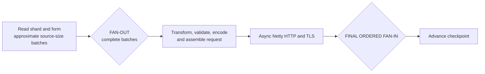
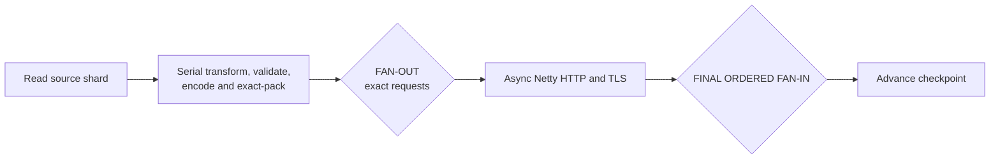
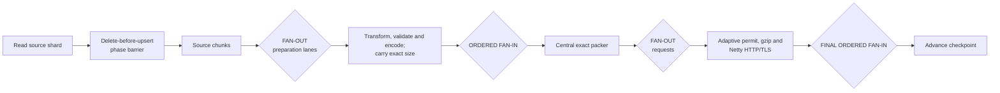
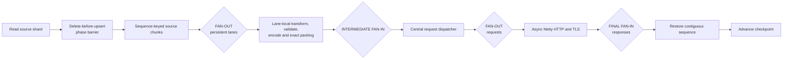
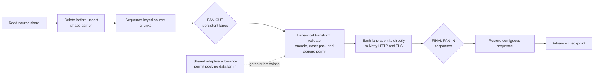

# RFS pipeline variants performance comparison — November 2026

## Purpose

This report compares five meaningfully different RFS pipeline structures,
including the RFS 3.4.0 release baseline, on the same 2.2-billion-document
snapshot and equivalent infrastructure. It omits parameter sweeps that did not
change the pipeline structure or produce a ten-percent performance difference.

The concise release comparison is
[`PERFORMANCE_COMPARISON_NOV_2026.md`](PERFORMANCE_COMPARISON_NOV_2026.md).
This report retains the additional structures, process measurements and
pipeline-stage evidence needed to understand why the final design was chosen.

## Equivalent test conditions

All selected runs used:

| Dimension | Common value |
|---|---|
| Snapshot | `rfs-quick-40m-v1` |
| Source contents | 2,200,000,000 documents in 40 primary shards |
| Stored snapshot size | Approximately 543 GiB |
| Transform | None |
| RFS fleet | 24 workers on an isolated on-demand `c6id.24xlarge` host |
| Worker resources | 3300m CPU, 7000 MiB memory and 100 GiB ephemeral storage |
| Request ceilings | 60 connections, 10 MiB and 20,000 documents |
| Target | OpenSearch 2.19; 24 `r6g.8xlarge.search` data nodes |
| Target storage | 1024 GiB gp3, 40,000 IOPS and 1,187 MiB/s per data node |
| Replicas | 0 |
| Completion requirement | 2.2 billion target documents and 40/40 completed shards |

Each selected run completed the full migration. Every retained
failed-document prefix was empty, and no selected target recorded a write
rejection, breaker trip, write block or failed node.

## Strategies

The strategy letters are used consistently in every table and diagram.

| ID | Strategy | Defining choice | Tested source |
|---|---|---|---|
| A | RFS 3.4.0 release direct batches | Approximate source-size batches are independently prepared and submitted | Upstream [`5d0e75376e0ad4e4cebf6e803031cee870e313d4`](https://github.com/opensearch-project/opensearch-migrations/commit/5d0e75376e0ad4e4cebf6e803031cee870e313d4), release 3.4.0 |
| B | Serial exact packer | Transform, validation, encoding and exact packing happen before request fan-out | Fork [`0c99474e6e7833f9ee0b8f512048dcda1ad01802`](https://github.com/gregschohn/opensearch-migrations/commit/0c99474e6e7833f9ee0b8f512048dcda1ad01802) |
| C | Parallel preparation, central packer | Preparation fans out, then one ordered exact packer forms requests | Fork [`01afbccc4b4887c336bf4c03cd9ddc437c7e58e9`](https://github.com/gregschohn/opensearch-migrations/commit/01afbccc4b4887c336bf4c03cd9ddc437c7e58e9) |
| D | Persistent lanes, central dispatcher | Stable preparation lanes pack requests, then merge into one dispatcher | Fork [`a14814c515ab2e9bf8bd8efc496a9e21de14dcf3`](https://github.com/gregschohn/opensearch-migrations/commit/a14814c515ab2e9bf8bd8efc496a9e21de14dcf3) |
| E | Direct persistent lanes | Stable lanes retain ownership through Netty submission and merge only responses | Final stack [`ae3eea93c5117233722eb3c4dfe4a64c7c5e8cc3`](https://github.com/gregschohn/opensearch-migrations/commit/ae3eea93c5117233722eb3c4dfe4a64c7c5e8cc3); topology experiment [`755e0ac6e3baa5051196323f0e44119861931761`](https://github.com/gregschohn/opensearch-migrations/commit/755e0ac6e3baa5051196323f0e44119861931761) |

Strategy E is the final topology. Its full rewritten stack was validated at
fork commit
[`ae3eea93c5117233722eb3c4dfe4a64c7c5e8cc3`](https://github.com/gregschohn/opensearch-migrations/commit/ae3eea93c5117233722eb3c4dfe4a64c7c5e8cc3).
The later transform-batching change selects the direct lanes only for the raw
path exercised by this snapshot, so it does not change the tested topology.

## Full-run results

Strategy C uses its selected 4,096-document preparation configuration. Its two
replications differed by four seconds. Other request-size, chunk-size and
preparation-count trials used the same central-packer structure and did not
produce a ten-percent difference, so they are not included.

| ID | Strategy | Full-run observations | Representative docs/s | Versus A |
|---|---|---:|---:|---:|
| A | RFS 3.4.0 release direct batches | 48m50.177s | 750,808 | Baseline |
| B | Serial exact packer | 52m50s | 694,006 | -7.57% |
| C | Parallel preparation, central packer | 46m41s and 46m37s; mean 46m39s | 785,995 | +4.69% |
| D | Persistent lanes, central dispatcher | 47m52s and 49m25s; mean 48m39s | 753,812 | +0.40% |
| E | Direct persistent lanes | 49m01.343s | 747,958 | -0.38% |

The fastest replicated result was C. Its central packer was not observed to
be a bottleneck for this workload, and its two executions were exceptionally
consistent.

B is retained because it is the clearest underfed design and is 11.7% slower
than C. Serial preparation saved CPU but delayed request production.

D and E are indistinguishable at the precision of these runs. The two
identical D executions differ by 3.24%, which is larger than E's 0.78%
difference from D's mean and E's 0.38% difference from A. Removing the central
dispatcher therefore simplified ownership and demand flow without establishing
a measurable completion penalty.

The A and E values are the definitive same-target comparison from November 8,
2026. CloudWatch work-coordination events provide millisecond boundaries from
the first shard acquisition through the last shard completion. Both runs used
the same target domain, isolated RFS node-pool SKU and pod resources.

| Fleet-utilization measure | A — RFS 3.4.0 | E — current direct lanes | Observed difference |
|---|---:|---:|---:|
| Average workers holding a shard lease | 19.82 of 24 | 20.18 of 24 | E averaged 0.36 more active workers |
| Shard-lease utilization | 82.57% | 84.07% | E was 1.50 percentage points higher |
| Documents per active-worker-second | 37,888 | 37,073 | E was 2.15% lower |

The full-run document rate is aggregate fleet throughput, including declining
concurrency during the final shard tail. Documents per active-worker-second
separates that fleet occupancy effect and shows a small worker-level regression
in E despite the nearly equal end-to-end completion time.

## Historical steady-state process performance

These are retained steady-state samples from the pipeline-shape experiments,
not the definitive A/E runs above and not full-run averages. A, B and E use
equivalent elapsed-minute-25 windows. C is the mean of its two replicated
fixed-window samples. D is the mean of its two elapsed-minute-20 samples. The
differing windows prevent treating small differences as causal.

| Measure | A | B | C | D | E |
|---|---:|---:|---:|---:|---:|
| Fleet document rate | Not emitted | 861,498/s | 959,662/s | 943,325/s | 860,748/s |
| CPU per worker | 2.10 cores | 2.41 cores | 2.80 cores | 2.77 cores | 2.74 cores |
| Documents/CPU-second | Not emitted | 14,899 | 14,293 | 14,183 | 13,098 |
| Working set per worker | 4.73 GiB | 3.73 GiB | 3.71 GiB | Not retained | 3.67 GiB |
| RSS per worker | 3.00 GiB | 1.95 GiB | Not retained | Not retained | 2.19 GiB |
| Bulk attempts | Not emitted | 80.98/s | 90.32/s | 88.83/s | 80.90/s |
| Mean HTTP attempt | Not emitted | 3.470s | 3.525s | 3.598s | 3.523s |

A used the least CPU and the most memory. E used approximately 30% more CPU
per worker but 22% less working-set memory and 27% less RSS. B achieved the
best measured documents per CPU-second but completed last because its serial
preparation path did not keep downstream work supplied.

C produced the best replicated completion and the highest selected
steady-state document rate. E consumed similar CPU but produced fewer requests
in its retained window. The available data cannot separate topology from
shard assignment and source-read variation at that precision.

## Pipeline-stage evidence

The newer metrics form this conservation chain:

`source → prepared → ordered_prepared → packed → request_started → request_completed → checkpointed`

A and B predate complete stage instrumentation. D and E provide the cleanest
topology comparison:

| Stage evidence | D | E |
|---|---:|---:|
| Source rate | 943,545 docs/s | 885,160 docs/s |
| Prepared rate | 943,545 docs/s | 885,139 docs/s |
| Packed rate | 943,620 docs/s | 885,276 docs/s |
| Request-completed rate | 942,184 docs/s | 884,166 docs/s |
| Checkpointed rate | 942,212 docs/s | 884,044 docs/s |
| Maximum rate spread across stages | 0.15% | 0.14% |
| Documents in active HTTP requests | Approximately 3.98M | Approximately 3.81M |
| Growing internal stage backlog | No | No |

Within each run, every stage sustained essentially the same rate. Neither
preparation, ordering, exact packing nor checkpoint restoration accumulated a
growing backlog. Most retained documents were inside active HTTP requests.

The stage metrics therefore rule out an obvious serialized preparation or
packing choke in D and E. They do not prove that the central dispatcher is
free: source production is demand-driven, and the two topologies can propagate
HTTP completion demand differently while still showing balanced neighboring
stages.

## Pipeline diagrams

### A — RFS 3.4.0 release direct batches

Performance: 48m50.177s and 750,808 docs/s; comparison baseline.

### B — Serial exact packer

Performance: 52m50s and 694,006 docs/s; 7.57% below A and 11.7% below C.

### C — Parallel preparation, central packer

Performance: replicated mean 46m39s and 785,995 docs/s; 4.69% above A.

### D — Persistent lanes, central dispatcher

Performance: replicated mean 48m39s and 753,812 docs/s; 0.40% above A.

### E — Direct persistent lanes

Performance: 49m01.343s and 747,958 docs/s; 0.38% below A.

## Decision summary

| ID | Finding |
|---|---|
| A | The RFS 3.4.0 CPU baseline is efficient, but approximate pre-transform sizing and higher retained memory do not meet the newer correctness and operational goals. |
| B | Exact sizing alone is insufficient when preparation is serialized; downstream request production is underfed. |
| C | Best replicated throughput. A central packer can keep up on this workload when preparation is supplied concurrently. |
| D | Stable lane ownership works, but the central dispatcher adds a merge and second fan-out without a demonstrated benefit. |
| E | Simplest final topology: one early fan-out, direct submission and one response fan-in. Its completion is within observed run variance of A and D. |

E was selected even though C recorded the highest throughput. E preserves
lane-local ownership through request submission, removes an intermediate merge
and supports the final transform-batching and ordering model. The evidence does
not establish that this structural simplification itself improves throughput;
it establishes that its measured cost is small relative to observed run
variance.

## Reproducibility

The commit links above must resolve to immutable tested source. Experimental
commits that will not merge upstream should remain reachable through permanent
`benchmark/rfs-quick40/` refs in the fork. Do not rebase or amend those refs:
the container digests and recorded results refer to the existing commit IDs.

The source identity alone is not sufficient to reproduce a run. Retain with
each result:

- the full image digest;
- snapshot and index identity;
- workflow configuration;
- worker and target hardware;
- UTC worker window;
- failed-document prefix; and
- final target document and shard counts.

The diagrams in this report are Mermaid source embedded in Markdown. They do
not depend on generated SVG pipeline images.

## Limitations

- Shard download and source-read time are material parts of the full result
  and vary with shard assignment.
- D's two identical runs differed by 3.24%, establishing nontrivial run
  variance even with equivalent infrastructure.
- The full-run A/E comparison has exact shard-acquisition boundaries, but the
  process and stage samples come from earlier structurally equivalent runs.
- A and B lack the complete newer application and stage metrics.
- These well-provisioned targets did not exercise adaptive limiting; separate
  constrained-target evidence evaluates overload behavior.
