# RFS quick-snapshot parallel pipeline comparison

Status: complete through the fourth parallel screen on 2026-11-06. Every
fourth-screen lane reached 40/40 shards and exactly 2.2 billion target
documents. Final failed-document prefixes were empty, and the targets
remained green with zero write rejections and breaker trips.

This report is intentionally separate from the 24-billion-document
full-capacity comparison. It contains every retained run of the smaller
`rfs-quick-40m-v1` snapshot made with the clamped RFS and target hardware
described below.

All timestamps shown beside commit IDs are Git committer timestamps in UTC.

## How to interpret this evidence

This is a multivariable pipeline experiment, not a greedy search for the
locally fastest knob. Several changes alter more than one effective factor:

- reducing preparation rails also changed the number of buffered documents;
- moving a fan-in changed both ownership of packing state and the point where
  downstream demand applies backpressure;
- changing the exact request cap changed request count, target service time,
  memory retention, and compression work together; and
- historical commits often combined correctness fixes, topology changes, and
  instrumentation.

The analysis therefore keeps four response variables separate:

1. full-run completion, including source startup and the final shard tail;
2. fixed-window steady-state document and request throughput;
3. client efficiency and pipeline occupancy; and
4. correctness and overload safety.

A configuration is not considered better merely because it wins one of those
measurements. The strongest evidence is a replicated, matched-hardware,
matched-snapshot comparison that agrees in both steady state and full
completion. A single matched run is provisional. Historical full-snapshot
comparisons are useful for identifying mechanisms and interactions, but not
for assigning a causal effect to one commit when other factors moved with it.

Correctness requirements are held fixed rather than treated as performance
knobs:

- exact post-transformation NDJSON sizing, including action metadata and
  newlines;
- valid single-line bulk NDJSON;
- delete-before-upsert ordering for ordered delta sources;
- contiguous checkpoint advancement despite out-of-order HTTP completion;
- bounded failed-document handling; and
- adaptive retry and admission-pressure protection.

The degrees of freedom are where and how early work fans out, where exact
packing state lives, how much prepared work is buffered, where response
streams merge, how downstream demand propagates, and how many requests are
kept ready for Netty.

## Conclusion

Nineteen retained migrations completed the same 2.2-billion-document
snapshot across four screens. The first two screens established the strongest
parameter-level result:

| Run | Variant | Request | Completion | Accepted docs/s |
|---|---|---:|---:|---:|
| S1-C10 | Current control | 10 MiB | 48m12s | 760,719 |
| S1-C5 | Current control | 5 MiB | 49m17s | 743,997 |
| S1-C20 | Current control | 20 MiB | 48m22s | 758,098 |
| S1-S1K | Four rails, 1,024-doc chunks | 10 MiB | **46m14s** | **793,079** |
| S1-L6K | Four rails, 6,144-doc chunks | 10 MiB | 46m42s | 785,153 |
| S1-P2 | Two rails, 4,096-doc chunks | 10 MiB | 46m41s | 785,434 |
| S2-C10 | Clean current control | 10 MiB | 50m19s | 728,718 |
| S2-P2S1K | Two rails, 1,024-doc chunks | 10 MiB | 48m48s | 751,366 |
| S2-P2L6K | Two rails, 6,144-doc chunks | 10 MiB | 47m18s | 775,194 |
| S2-P2 | Two rails, 4,096-doc chunks | 10 MiB | **46m37s** | **786,557** |

The strongest result is the repeatability of the two-rail, 4,096-document
configuration. Its two full runs took 46m41s and 46m37s: a four-second spread.
Their 46m39s mean is 7.3% shorter than the clean 50m19s second-screen control
and corresponds to 7.9% more accepted documents per second.

The single fastest completion was the four-rail, 1,024-document run at 46m14s,
but it was not replicated. The two-rail, 6,144-document combination led both
second-screen steady-state windows, yet finished 41 seconds behind the
two-rail 4,096-document run because of its final shard mix. One more paired
replication is needed before preferring it.

All ten runs reached exactly 2,200,000,000 target documents and 40/40 primary
shards. The retained failed-document prefixes were empty. There were no target
write rejections, breaker trips, write blocks, lost target nodes, retry
exhaustion failures, or incomplete migrations.

The fourth screen then tested the structural question directly:

| Run | Shape | Completion | Accepted docs/s | Vs RFS 3.4.0 |
|---|---|---:|---:|---:|
| P4-IM | Intermediate lane merge | 47m52s | 766,017 | +2.82% |
| P4-IM replicate | Intermediate lane merge | 49m25s | 741,990 | -0.41% |
| P4-DJ | Direct lanes; only final response fan-in | 49m38s | 738,751 | -0.84% |
| RFS 3.4.0 reference | Direct approximate batching | 49m13s | 745,005 | Baseline |

P4-DJ meets the goal: it is only 0.84% slower than the RFS 3.4.0 reference,
well inside the allowed 8%. The two identical P4-IM runs differ by 3.24%, so
their apparent advantage over P4-DJ is not distinguishable from run variance.
The new stage metrics show balanced rates from `source` through
`checkpointed`, no growing preparation or packing inventory, and no evidence
that the intermediate fan-in is a throughput bottleneck.

The recommended structure is therefore P4-DJ: fan out once into four
persistent preparation/packing/submission lanes, submit directly to Netty
under one shared adaptive permit pool, and fan in only completed responses to
restore contiguous checkpoint order. This choice is supported by its simpler
demand path and measured performance equivalence, not by a claim that it is
faster.

All three fourth-screen targets finished green with exactly 2.2 billion
documents, empty failed-document prefixes, zero cumulative write rejections,
and zero breaker trips. One P4-IM poll observed a transient aggregate write
queue depth of 11; it returned to zero without a rejection, limit cut, or
failed document.

## Scope and common hardware

| Dimension | Value |
|---|---|
| Snapshot | `rfs-quick-40m-v1` |
| Index | `pilot_index_quick_40m` |
| Documents | 2,200,000,000 |
| Primary shards | 40 |
| Stored snapshot size | Approximately 543 GiB |
| Largest shard | Approximately 13.64 GiB |
| RFS workers | 24 |
| Worker resources | 3300m CPU, 7000 MiB memory, 100 GiB ephemeral storage |
| RFS placement | One isolated on-demand `c6id.24xlarge` per EKS environment |
| Connections | Adaptive, at most 60 per worker |
| Transform | None; raw NDJSON fast path |
| Failed-document stream | Enabled with a unique prefix per run |
| Target data nodes | 24 x `r6g.8xlarge.search` |
| Dedicated masters | 3 x `r6g.large.search` |
| Target storage | 1024 GiB gp3 per data node |
| Storage performance | 40,000 IOPS and 1,187 MiB/s per data node |
| Replicas | 0 |
| Target engine | OpenSearch 2.19 |

Each lane used its own EKS environment, isolated RFS host, and target domain.
The second screen reused lanes 2–5 only after deleting the test index; the
domains and their capacity were not recreated or resized.

## Runs included

Short run IDs keep the result tables readable.

| Run | Screen/lane | Code | Pipeline setting |
|---|---|---|---|
| S1-C10 | 1/1 | `e3b8c370d` | 4 rails; 4,096 docs; 10 MiB |
| S1-C5 | 1/2 | `e3b8c370d` | 4 rails; 4,096 docs; 5 MiB |
| S1-C20 | 1/3 | `e3b8c370d` | 4 rails; 4,096 docs; 20 MiB |
| S1-S1K | 1/4 | `c26fa9d1` | 4 rails; 1,024 docs; 10 MiB |
| S1-L6K | 1/5 | `aaf65a6a` | 4 rails; 6,144 docs; 10 MiB |
| S1-P2 | 1/6 | `01afbccc` | 2 rails; 4,096 docs; 10 MiB |
| S2-C10 | 2/2 | `e3b8c370d` | 4 rails; 4,096 docs; 10 MiB |
| S2-P2S1K | 2/3 | `c1b655df` | 2 rails; 1,024 docs; 10 MiB |
| S2-P2L6K | 2/4 | `83a19703` | 2 rails; 6,144 docs; 10 MiB |
| S2-P2 | 2/5 | `01afbccc` | 2 rails; 4,096 docs; 10 MiB |

Commit provenance:

- `e3b8c370d` (2026-11-06 06:25:38): instrument pipeline bottlenecks;
- `c26fa9d1` (2026-11-06 07:26:04): use 1,024-document preparation chunks;
- `aaf65a6a` (2026-11-06 07:29:41): use 6,144-document preparation chunks;
- `01afbccc` (2026-11-06 07:30:34): cap preparation at two rails;
- `c1b655df` (2026-11-06 08:24:57): combine two rails with 1,024-document
  chunks; and
- `83a19703` (2026-11-06 08:25:51): combine two rails with 6,144-document
  chunks.

## Third screen: pipeline-shape matrix

The first two screens varied request size, preparation rail count, and chunk
size without changing the fundamental pipeline topology. The third screen
instead compares historical code shapes on six otherwise matched lanes. All
diagrams run left to right.

| Lane | Code | Structural distinction |
|---|---|---|
| 1 | `748443939` | Transform and repack across a bounded group of source batches |
| 2 | `0c99474e6` | Prepare and size documents serially before request-group fan-out |
| 3 | `7a31e44d2` | Fan preparation batches out after the write-phase barrier |
| 4 | `8748e1d5b` | Stream smaller bounded preparation chunks into an exact packer |
| 5 | `e3b8c370d` | Current bounded-streaming shape with bottleneck instrumentation |
| 6 | RFS `3.4.0` | Approximate source batching followed directly by request fan-out |

Every lane uses 24 workers, a 10 MiB/20,000-document request ceiling, at most
60 connections per worker, the quick snapshot, the isolated RFS host, and the
target hardware listed above. Workers are released together only after all
six coordinators and zero-replica Deployments are ready.

### Lane 1 — grouped transform and repack

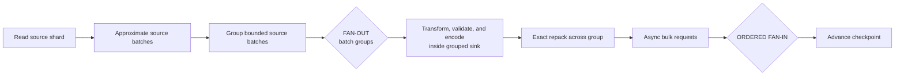

### Lane 2 — serial preparation before request fan-out

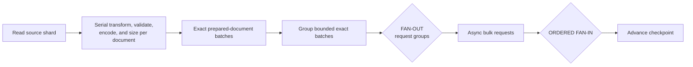

### Lane 3 — phase-gated parallel preparation

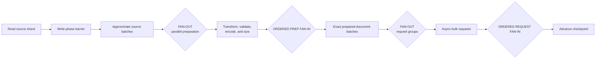

### Lane 4 — bounded streaming preparation

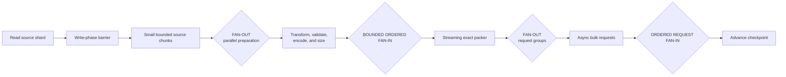

### Lane 5 — current instrumented bounded stream

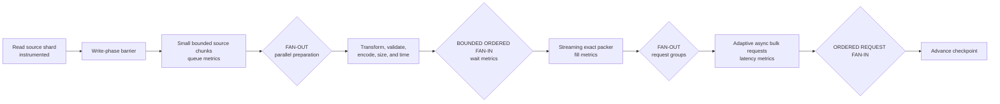

### Lane 6 — RFS 3.4.0 direct batching

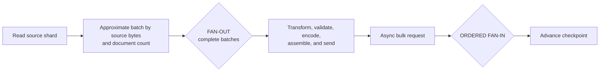

### Third-screen outcomes

All six targets reached exactly 2.2 billion documents and 40/40 shards with
zero retained failed-document objects. Lanes 3 and 4 were already reset
before their exact SnapshotMigration start fields were captured, so their
windows below use the first and last worker evidence and are approximate.

| Lane | Code | Backfill/worker window UTC | Completion | Docs/s | Vs 3.4.0 |
|---|---|---|---:|---:|---:|
| 1 | `748443939` (05:29:25) | 14:21:42–15:14:17 | 52m35s | 697,306 | -6.40% |
| 2 | `0c99474e6` (05:29:30) | 14:18:28–15:11:18 | 52m50s | 694,006 | -6.85% |
| 3 | `7a31e44d2` (05:29:34) | ~14:03:32–14:52:07 | ~48m35s | ~754,755 | ~+1.31% |
| 4 | `8748e1d5b` (05:29:34) | ~14:11:39–14:59:11 | ~47m32s | ~771,326 | ~+3.53% |
| 5 | `e3b8c370d` (06:25:38) | 14:01:51–14:50:48 | 48m57s | 749,064 | +0.54% |
| 6 | RFS `3.4.0` | 14:23:32–15:12:45 | 49m13s | 745,005 | Baseline |

The exact-duration lanes all satisfy the current no-more-than-8%-slower
criterion, including the two earlier serial/grouped shapes. Full completion
alone therefore does not identify which newer operator is beneficial.

The closest available elapsed-minute-25 steady-state slices were:

| Lane | Docs/s | CPU cores | Docs/CPU-s | Attempts/s | HTTP latency | Request docs | CFS throttled |
|---|---:|---:|---:|---:|---:|---:|---:|
| 1 grouped | 890,496 | 58.07 | 15,334 | 87.52 | 3.904 s | 10,174 | 20.2% |
| 2 serial carry | 890,839 | 56.91 | **15,655** | 83.81 | **3.543 s** | 10,630 | **8.3%** |
| 3 phase-parallel | 950,485 | 66.86 | 14,216 | 89.39 | 3.664 s | 10,632 | 25.2% |
| 4 bounded stream | **954,082** | 66.94 | 14,253 | **89.73** | 3.685 s | 10,632 | 22.9% |
| 5 instrumented current | 918,534 | 66.48 | 13,817 | 86.39 | 3.586 s | 10,631 | 21.4% |

Lane 6 lacks the new Prometheus stage instruments. Lanes 1–4 also predate the
complete stage-counter set, so only lane 5 can be decomposed with the newest
source-to-checkpoint accounting. This is why the historical shapes identify
plausible interactions but cannot isolate one operator's causal cost.

## Fourth screen: runs in the direct-lane tranche

This tranche executed the runs needed to answer the structural question:

1. P4-IM measures the already-built intermediate implementation so the cost
   and demand semantics of its pre-Netty lane merge are visible.
2. P4-DJ removes that merge and carries each lane directly through exact
   packing and Netty submission.

The proposed P4-DN string-aware normalization variant was not run. P4-DJ
already met the performance target, and the stage evidence did not identify
Jackson validation as the limiting operator. Replacing a correctness boundary
without evidence of a relevant bottleneck would entangle another decision
without improving this comparison.

The live RFS container has a 3,300 millicore CPU limit and Java reports four
available processors, so every new candidate uses four persistent CPU lanes.

The shared adaptive allowance in the direct-lane diagrams is not a fan-in: it
is one process-wide permit pool that gates submissions without taking
ownership of, ordering, grouping, or serially processing lane data. Each lane
submits its own fully packed requests directly to Netty. The first data-path
fan-in is after HTTP responses, where completed source sequences must be
combined to advance a contiguous checkpoint.

The delete-before-upsert rule is a lifecycle barrier outside the hot path:
the delete pipeline completes, then a fresh upsert pipeline starts. It does
not require merging lane traffic within either phase.

| Run | Status | Shape | NDJSON handling |
|---|---|---|---|
| P4-IM | Completed, 15:22:52–16:10:44 UTC | Intermediate lane merge | Jackson streaming-token validation |
| P4-IM replicate | Completed, 15:17:26–16:06:51 UTC | Intermediate lane merge | Jackson streaming-token validation |
| P4-DJ | Completed, 15:24:39–16:14:17 UTC | Direct persistent lanes | Jackson streaming-token validation |

Every run uses the same quick snapshot, 24 workers, 10 MiB/20,000-document
request ceiling, 60-connection ceiling, isolated `c6id.24xlarge` RFS host,
and matched 24-node target described above. The completed 3.4.0 run remains
the external performance reference; it does not need another proposed-run
diagram here.

P4-IM and its independently started replicate use signed commit
`a14814c51` (2026-11-06 14:37:18 UTC) and image digest
`sha256:95f587809443202481868ecefff07df4d9b00729c6647f0571467cf85c13dd93`.
The replicate runs on `rfsq07`; its backfill started at 15:17:26 UTC.
P4-DJ uses signed commit `755e0ac6e` (2026-11-06 15:12:45 UTC) and image digest
`sha256:4f3ddcdaf62a5b1aa8e563b30b78dfe6d2f86ede43db9e17c3fdfa82cfae786a`.

### P4-IM — intermediate lane-merge control

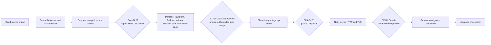

This intermediate image is useful as a measured control, but its lane merge,
request-group boundary, and second fan-out are the operators under test. On
the raw fast path used here, its preferred source-batch group size is one:
the boundary does not accumulate eight exact requests into a larger group.
It still merges lane publishers into one shared request dispatcher before
Netty. It is not the recommended shape.

### P4-DJ — four direct lanes with Jackson validation

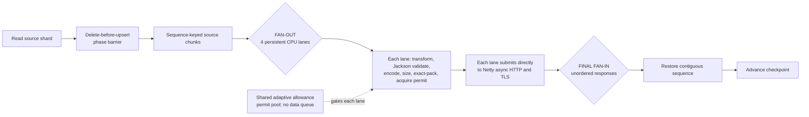

P4-DJ has one early fan-out and one final fan-in. There
is no preparation merge, global packer, shared ready-request queue, request
regrouping, or second fan-out. Each lane owns its transform/validation,
encoding, exact-packing, and request-submission path. Ordering is restored
only at the checkpoint boundary after HTTP responses complete.

## Pipeline-stage evidence

The stage metrics provide the primary coordinate system for the topology
analysis. For every worker they count documents at:

1. `source`: a source chunk becomes available to preparation;
2. `prepared`: transform/validation/encoding finishes;
3. `ordered_prepared`: the chunk is released in the order required by its
   current topology;
4. `packed`: exact request packing emits a batch;
5. `request_started`: the request publisher is subscribed;
6. `request_completed`: the request group succeeds; and
7. `checkpointed`: its source progress can be committed contiguously.

Rates show whether a stage is sustaining upstream flow. Differences between
the process-lifetime counters show documents retained between stages at the
evaluation instant. The latter are more useful than comparing histogram names
alone because the physical meaning of an “ordered wait” or “request group”
can move when the topology changes.

The first clean, common wall-clock ten-minute P4 window was 15:31–15:41 UTC.
It is useful for stage balance, but the runs had different start times:

| Stage document rate/s | P4-DJ direct | P4-IM merged |
|---|---:|---:|
| Source available | 885,160 | 943,545 |
| Prepared | 885,139 | 943,545 |
| Released from preparation order | 885,139 | 943,545 |
| Exactly packed | 885,276 | 943,620 |
| Request started | 885,276 | 943,620 |
| Request completed | 884,166 | 942,184 |
| Checkpointed | 884,044 | 942,212 |

| Outstanding documents at 15:41 UTC | P4-DJ direct | P4-IM merged |
|---|---:|---:|
| Source available but not prepared | 24,576 | 8,192 |
| Prepared but waiting for ordered release | 0 | 0 |
| Released but retained by exact packers | 419,594 | 470,618 |
| Packed but not request-started | 0 | 0 |
| Request-started but not completed | 3,812,019 | 3,983,291 |
| Request-completed but not checkpointable | 405,059 | 383,467 |

Every stage rate within a run is within about 0.2% of its neighbors. There is
no growing preparation, ordered-release, packing, or checkpoint backlog in
this window. Most in-process documents are in active HTTP requests, as
expected, and P4-DJ carries about 171,000 fewer of them. That agrees with its
lower request attempt rate and lower in-flight gauge.

This narrows the first P4 difference but does not by itself assign its cause.
Source production is demand-driven, so equal neighboring stage rates can mean
the whole chain is flowing cleanly at a downstream-determined rate. Preparation
queue wait is only 0.17–0.19 ms, ordered-release wait 0.41–0.43 ms, and request
queue wait 0.93–0.96 ms; none is large enough to explain a 6% fleet-rate gap
as serialized service time. The remaining candidates are:

- the response/completion demand propagated through each topology;
- uninstrumented source-read/decode service before `source`;
- CPU scheduling and gzip/TLS work outside the preparation histogram; and
- ordinary shard/AZ variance, which the replicate and full completion later
  show is material.

The configured `pipelinePreparationReservoirChunks` gauge is a capacity
setting, not current occupancy. The live occupancy signals are queued,
active, and ordered preparation chunks/documents/bytes. The report does not
treat the configured 288 fleet chunks as 288 full resident chunks.

The P4-IM replicate on `rfsq07` had equivalent stage balance during the same
window, but its metrics endpoint was repaired only at 15:31 UTC and its run
was already farther into its shard population. It is evidence about stage
balance, not a same-elapsed throughput replicate. Once its first 24 shards
completed, the excess Deployment replicas began the normal exit-code-4 loop:
the coordinator reported work existed but no remaining shard was claimable.
That is worker-pool lifecycle churn, not a failed work item, but it makes
post-transition process-lifetime stage totals unsuitable for comparison.

### Separating shard setup from the instrumented pipeline

The first `source` stage event occurs only after the worker downloads and
unpacks its assigned shard. Worker phase-transition logs therefore provide a
necessary outer boundary around the new stage metrics. Among the first 16
completed work items still retained in each fleet's live pod logs:

| Run | Mean shard download/setup | Mean instrumented migration |
|---|---:|---:|
| P4-DJ direct | 182.4 s | 1,454.1 s |
| P4-IM merged | 171.0 s | 1,419.9 s |
| P4-IM replicate | 179.8 s | 1,465.6 s |

The shard populations in that table are not identical. Restricting the
comparison to the 11 shard IDs present in all three log sets gives migration
means of 1,460.3 s, 1,418.9 s, and 1,467.3 s respectively. P4-DJ is 1.2%
slower than the mean of the two P4-IM runs, while the same-code P4-IM pair
differs by 3.4%. That does not establish a direct-lane penalty.

Second-wave shard setup is much faster and also variable: the fleet means for
the 16 current work items are 47.1 s, 61.8 s, and 38.4 s. Full backfill time
therefore combines a material, topology-independent setup distribution with
the actual source-to-checkpoint pipeline. The final ranking uses both:

1. the outer worker phase for user-visible completion; and
2. stage rates, counter gaps, and per-shard migration duration for pipeline
   causality.

At exactly 20 minutes after each backfill began, five-minute windows reduce
that phase mismatch:

| Measure at elapsed minute 20 | P4-DJ direct | P4-IM merged | P4-IM replicate |
|---|---:|---:|---:|
| Accepted documents/s | 908,944 | 955,092 | 931,558 |
| Attempts/s | 85.56 | 89.95 | 87.70 |
| CPU cores | 65.27 | 66.71 | 66.31 |
| Documents/CPU-s | 13,927 | 14,317 | 14,048 |
| Mean HTTP attempt | 3.699 s | 3.735 s | 3.460 s |
| Request-start gap/process | 274.7 ms | 266.7 ms | 271.9 ms |
| Preparation/chunk | 12.68 ms | 12.76 ms | 12.96 ms |
| Packing/chunk | 0.132 ms | 0.136 ms | 0.136 ms |
| Request assembly | 3.67 ms | 3.64 ms | 3.61 ms |
| Gzip compression | 39.05 ms | 39.48 ms | 40.38 ms |
| Response classification | 61.13 ms | 60.90 ms | 66.28 ms |
| Active request groups | 334.7 | 349.8 | 321.4 |
| Wire throughput | 66.4 MiB/s | 69.7 MiB/s | 68.1 MiB/s |
| Target CPU average | 53.1% | 55.5% | 51.7% |
| Target indexing latency | 0.316 ms | 0.320 ms | 0.302 ms |
| Process-rate p10 | 34,169 docs/s | 39,034 docs/s | 36,982 docs/s |
| Process-rate p50 | 37,105 docs/s | 39,813 docs/s | 38,693 docs/s |
| Process-rate p90 | 40,959 docs/s | 40,782 docs/s | 40,391 docs/s |

The two P4-IM lanes average 943,325 documents/s in this slice, 3.8% above
P4-DJ. Their 2.5% separation is also a direct estimate of run-to-run variance
for the same code. P4-DJ has a much wider per-worker rate distribution: its
fast workers match P4-IM, while its lower tail does not. The stage rates still
remain balanced within each worker. This points to either shard/source
heterogeneity interacting with lane-local demand or ordinary assignment/AZ
variance, not a fleet-wide serialized packing stage.

Full completion does not preserve the fixed-window ranking. P4-DJ completed
in 49m38s. The two P4-IM runs completed in 47m52s and 49m25s, a 3.24%
same-code spread. P4-DJ is 2.0% slower than the duration-derived mean of
those runs and 0.44% slower than the replicate; neither difference is larger
than the observed run variance. The 3.8% minute-20 difference is therefore
not evidence of a causal topology penalty.

The request-start interval is about 3% longer on P4-DJ than P4-IM, while
assembly, compression, classification, and target indexing latency are close.
Its active-request population is essentially equal to the mean of the two
P4-IM runs. Compressed wire traffic is only 66–70 MiB/s per fleet and scales
with document rate; it is an output of the rate difference, not evidence of a
network ceiling.

Multiplying measured stage frequency by mean synchronous stage duration
accounts for only about one fifth of container CPU in all three variants.
This is not a CPU-profiler substitute, but it locates the major telemetry
blind spot before `source`: snapshot/Lucene read and decode, document
construction, and Reactor delivery into source chunks. TLS and runtime work
outside the stage histograms also remain in that residual. If full completion
does not resolve the topology ranking, source-read/decode service time is the
next metric or trace boundary to add; more packing instrumentation would not
address the dominant unknown.

## Decision ledger and known interactions

The entries below distinguish a decision's intended effect from what the
measurements actually establish. “Not isolated” means another material factor
changed at the same time.

### Exact post-transformation request sizing

This is a correctness constraint. RFS 3.4.0 bounded source-body bytes before
adding action metadata and NDJSON separators, so its nominal 10 MiB batches
could be larger on the target wire. Current code carries the encoded size with
each prepared document and packs against the complete uncompressed request.

The historical matched-document experiment indicates that approximately
11,319 documents and 10.652 MiB of complete NDJSON reproduced the old
batch population, while current exact 10 MiB requests contain approximately
10,620 documents. That is roughly 6.6% fewer documents per request and can
require roughly 6.6% more request completions for the same migration.

That does not imply that simply increasing the request cap wins. In the
full-snapshot comparison, the 6.54% larger requests took 13.90% longer at the
target and request rate fell 7.85%. In the quick request-size screen, 20 MiB
requests used much more memory and had about four times the latency of 5 MiB
requests without improving full completion. Request size therefore interacts
with the target's service-time curve.

### Raw NDJSON validation and normalization

Current raw-path preparation performs Jackson streaming-token validation and
single-line normalization before final packing. P4-IM and P4-DJ use the same
implementation, so this cost cancels in their direct comparison. Their first
matched ten-minute window measured 12.50–12.69 ms per preparation chunk, a
much smaller relative difference than their request-production difference.

String-aware newline normalization remains an untested candidate, not an
assumed optimization. It must preserve JSON strings and escapes, reject
malformed input safely, and retain exact post-normalization sizing before it
can replace Jackson validation.

### Cross-source-batch repacking

Repacking transformed output across source batches fixed under-filled bulk
requests, but it also introduced a larger checkpoint/grouping window. The
large-snapshot rate fell 15.08% between adaptive 0709 and instrumented 87ac,
an interval that also changed raw preparation timing, grouping, and
instrumentation. The full loss cannot be assigned to repacking alone.

The quick third-screen grouped and serial-carry shapes were only 6.40% and
6.85% slower than the quick RFS 3.4.0 reference. That is evidence that the
historical 15% step involved interactions or environment variance, rather
than proof that one repacking operator costs 15%.

### Preparation fan-out and its ordered fan-in

Java sees four processors inside each 3300m worker container. Four preparation
rails are therefore a plausible upper bound, not evidence that four rails are
optimal. Reducing to two rails improved the earlier quick runs, but also
halved the nominal prepared reservoir from 49,152 to 24,576 documents. The
observed gain is a combined rail-count, buffering, scheduling, and memory
effect.

The four-rail current shape commonly spent 37–50% of CFS scheduling periods
throttled in the third screen, while the serial-carry shape was around 8% in
one matched window. Nevertheless, the current shape completed that full quick
run faster. CFS throttling identifies runnable work beyond the CPU quota; it
does not by itself identify harmful lost throughput.

### Bounded chunks and the prepared reservoir

Bounded streaming reduced measured preparation time by 77% in the historical
full-snapshot comparison, yet successful request rate and end-to-end
throughput did not improve. Preparation was not the only limiting stage.

Small chunks increase scheduling and ordered-release frequency. Large chunks
hold more work per task and reduce scheduling boundaries, but can delay the
oldest document and make lane imbalance coarser. The two-rail 1,024-document
run showed backlog and higher memory; the 6,144-document run led steady state
but lost in the shard tail. No single chunk size is established as globally
optimal.

### Pooled assembly buffers

The pool reuses bounded heap byte arrays for request assembly; it is not
Netty's pooled direct-buffer allocator. It should reduce allocation and GC
pressure, but no retained EKS pair changes only pooling. The adjacent
historical runs also changed preparation fan-out and chunk streaming, so an
independent throughput effect is not established.

### Persistent CPU lanes

Persistent lanes keep preparation and packing state on stable single-thread
schedulers, avoiding repeated scheduling of independent chunks. P4-IM then
merges packed requests into a shared dispatcher. P4-DJ instead retains each
lane through request submission and merges only completed checkpoint
contributions.

The first common wall-clock P4 window does not show a direct-lane benefit:

| Measure, 15:31–15:41 UTC | P4-DJ direct | P4-IM merged |
|---|---:|---:|
| Accepted documents/s | 884,044 | 942,212 |
| Attempts/s | 83.26 | 88.72 |
| Mean request documents | 10,620 | 10,620 |
| Mean request size | 10.000 MiB | 10.000 MiB |
| Mean HTTP attempt | 3.385 s | 3.548 s |
| Requests in flight | 294.9 | 324.3 |
| Adaptive allowance | 789.5 | 803.3 |
| Slot waiters | 0 | 0 |
| Preparation/chunk | 12.50 ms | 12.69 ms |
| Packing/chunk | 0.140 ms | 0.138 ms |

P4-DJ had slightly lower HTTP latency and preparation cost, but it produced
6.2% fewer attempts and kept 9.1% fewer requests in flight. The adaptive
allowance was not binding. Removing an intermediate merge therefore did not
remove the observed limiter; it changed how downstream demand reaches the
lane-local request publishers.

The elapsed-minute-20 comparison reduces the gap to 3.8% versus the mean of
the two P4-IM lanes. Full completion and matched-shard phase evidence show
that this remains inside the combined same-code and shard-phase variance
established by the tranche.

One code-level interaction remains worth instrumenting if future workloads
show a repeatable direct-lane deficit: the direct
implementation merges each lane's *completed checkpoint contributions* with
an outer `flatMap` prefetch of one. That downstream boundary may constrain a
lane based on completion emission rather than packed-request availability,
even though its internal HTTP `flatMap` is asynchronous. This is a
mechanism-supported hypothesis, not a finding from these runs.

### Adaptive target-aware flow control

Adaptive limiting is inactive as a performance constraint in these
well-provisioned-target runs: allowance remains far above in-flight requests,
slot waiters are zero, and there are no cuts. It cannot explain the quick-run
throughput ordering.

It is not optional under overload. In the retained constrained-target pair,
adaptive code produced about 456 times fewer indexing-pressure rejections,
kept target queues and heap lower, avoided current-generation terminal
document failures, and accepted 15.2% more documents over 8h35m. Its impact
depends strongly on target-pressure regime.

### Phase and checkpoint ordering

The delete-before-upsert phase barrier is a pass-through for this
full-snapshot benchmark, so the test cannot measure its delta-workload
benefit. It remains required for correctness when a source emits deletes
before upserts.

Checkpoint restoration is also required, but its placement and demand
semantics remain tunable. HTTP requests may complete out of order; only
contiguous source progress may be committed. The implementation should retain
enough completed-but-not-yet-committable state that checkpoint head-of-line
blocking does not feed back into request production.

## Confidence and remaining causal gaps

High-confidence findings:

- the target and adaptive limiter are not constraining the quick runs;
- exact request sizes and failed-document correctness are being preserved;
- Java reports four processors for the 3300m container;
- no measured stage between `source` and `checkpointed` develops a growing
  backlog in P4-DJ or P4-IM;
- P4-DJ completes only 0.84% slower than RFS 3.4.0 and satisfies the 8%
  performance goal;
- the P4-IM same-code completion spread is larger than P4-DJ's difference
  from either the 3.4.0 reference or the P4-IM duration mean; and
- adaptive control materially improves safety and useful throughput in the
  constrained-target regime.

Medium-confidence findings:

- rail count, buffer inventory, and scheduling must be tested as interacting
  factors rather than as one knob;
- larger requests are on a worse target-latency region for these domains; and
- direct persistent lanes are performance-equivalent to the intermediate
  merge for this snapshot and hardware.

Not yet established:

- an independent benefit from buffer pooling;
- an independent cost from Jackson validation;
- whether two or four rails is best at a fixed reservoir;
- whether checkpoint restoration can suppress upstream direct-lane
  concurrency under a workload with a wider completion-order skew; and
- how much of the residual CPU lies in source read/decode versus TLS and
  runtime work, because those boundaries remain outside the stage timers.

## First two screens: full completion and correctness

The rates below are the final 2.2-billion-document target count divided by the
backfill duration. “Rate vs control” uses the clean second-screen control,
S2-C10.

| Run | Backfill window, UTC | Duration | Docs/s | Rate vs control | Failed |
|---|---|---:|---:|---:|---:|
| S1-C10 | 08:35:31–09:23:43 | 48m12s | 760,719 | +4.39% | 0 |
| S1-C5 | 07:48:30–08:37:47 | 49m17s | 743,997 | +2.10% | 0 |
| S1-C20 | 07:48:31–08:36:53 | 48m22s | 758,098 | +4.03% | 0 |
| S1-S1K | 07:49:11–08:35:25 | **46m14s** | **793,079** | **+8.83%** | 0 |
| S1-L6K | 07:49:03–08:35:45 | 46m42s | 785,153 | +7.74% | 0 |
| S1-P2 | 08:02:34–08:49:15 | 46m41s | 785,434 | +7.78% | 0 |
| S2-C10 | 08:49:04–09:39:23 | 50m19s | 728,718 | Baseline | 0 |
| S2-P2S1K | 08:50:11–09:38:59 | 48m48s | 751,366 | +3.11% | 0 |
| S2-P2L6K | 08:50:43–09:38:01 | 47m18s | 775,194 | +6.38% | 0 |
| S2-P2 | 08:49:56–09:36:33 | **46m37s** | **786,557** | **+7.94%** | 0 |

S1-C10 is retained because it completed on the same hardware, but it is not a
clean control. Its startup included 69 worker restarts while all workers
contended with the small coordinator's TLS handshakes. It recovered without
lost work or manual intervention. S2-C10 had zero worker restarts and is the
better current-code baseline.

The ordinary exit-code-4 recycling seen near the end of some first-screen runs
was not a failure. Those workers had committed their work items, and the
coordinator had no remaining claimable shard for the excess replicas.

## Matched steady-state evidence

### First screen

The first-screen fixed windows were 08:02:30–08:12:30 UTC for S1-C5 through
S1-L6K and 08:07:30–08:17:30 UTC for the later-starting S1-P2.

| Run | Docs/s | MiB/s | CPU cores | Docs/CPU-s | Memory | Attempts/s | Latency |
|---|---:|---:|---:|---:|---:|---:|---:|
| S1-C5 | 906,274 | 791.8 | 66.2 | 13,682 | 76.5 GiB | 170.6 | 1.77 s |
| S1-C20 | 946,883 | 827.2 | 66.3 | 14,285 | 132.3 GiB | 44.5 | 7.22 s |
| S1-S1K | 971,150 | 848.4 | 66.8 | 14,529 | 93.7 GiB | 91.4 | 3.63 s |
| S1-L6K | 958,503 | 837.4 | 66.5 | 14,417 | 93.9 GiB | 90.2 | 3.61 s |
| S1-P2 | 970,563 | 848.5 | 67.4 | 14,396 | 86.8 GiB | 91.4 | 3.39 s |

No lane had an adaptive cut, failed document, target rejection, or persistent
write queue in its fixed window. The 20 MiB requests doubled latency and used
roughly 56 GiB more fleet memory than 5 MiB requests without winning
completion time. The three 10 MiB candidates were within about one percent in
this screen.

### Second screen

The second screen supplied a clean 10 MiB control and two consecutive
ten-minute windows.

#### 08:54:30–09:04:30 UTC

| Run | Docs/s | Vs control | MiB/s | CPU cores | Docs/CPU-s | Memory | Attempts/s | Latency |
|---|---:|---:|---:|---:|---:|---:|---:|---:|
| S2-C10 | 864,048 | — | 755.4 | 66.4 | 13,014 | 79.3 GiB | 81.34 | 3.243 s |
| S2-P2S1K | 915,118 | +5.9% | 800.0 | 64.8 | 14,125 | 94.2 GiB | 86.15 | 3.247 s |
| S2-P2L6K | 948,771 | +9.8% | 829.4 | 66.9 | 14,187 | 90.8 GiB | 89.33 | 3.286 s |
| S2-P2 | 938,212 | +8.6% | 820.2 | 66.8 | 14,035 | 83.2 GiB | 88.35 | 3.301 s |

#### 09:05:30–09:15:30 UTC

| Run | Docs/s | Vs control | MiB/s | CPU cores | Docs/CPU-s | Memory | Attempts/s | Latency |
|---|---:|---:|---:|---:|---:|---:|---:|---:|
| S2-C10 | 844,766 | — | 737.8 | 66.6 | 12,693 | 86.9 GiB | 79.43 | 3.553 s |
| S2-P2S1K | 933,624 | +10.5% | 815.4 | 64.6 | 14,453 | 97.7 GiB | 87.81 | 3.638 s |
| S2-P2L6K | 975,674 | +15.5% | 852.1 | 67.2 | 14,523 | 94.4 GiB | 91.75 | 3.726 s |
| S2-P2 | 948,760 | +12.3% | 828.6 | 66.9 | 14,189 | 91.5 GiB | 89.23 | 3.659 s |

All four averaged approximately 10.00 MiB and 10,621 documents per request.
The candidates were not faster because of smaller requests or lower target
latency. They kept more request groups active:

| Run | Requests in flight | Active groups | Adaptive allowance | Slot waiters |
|---|---:|---:|---:|---:|
| S2-C10 | 273.8 | 278.5 | 703.0 | 0 |
| S2-P2S1K | 290.7 | 295.0 | 708.6 | 0 |
| S2-P2L6K | 306.7 | 312.5 | 754.7 | 0 |
| S2-P2 | 298.3 | 303.5 | 705.7 | 0 |

The adaptive allowance stayed above actual in-flight work, and there were no
slot waiters. Adaptive limiting was not the bottleneck. The throughput
difference maps almost exactly to request rate.

The 1,024-document interaction accumulated a small ordered-preparation backlog
and used the most memory. The larger chunks avoided that extra scheduling
boundary and produced the highest steady-state request concurrency. Its slower
full completion than S2-P2 was confined to the final shard tail.

## Effective pipeline configurations

These values came from the pipeline configuration gauges during the runs. A
chunk was bounded by both its document cap and the run's byte cap. “Nominal
docs” is chunk cap multiplied by total reservoir chunks; it is not a claim
that every chunk was simultaneously full.

| Configuration | Prep rails | Chunk cap | Chunks/rail | Reservoir | Nominal docs | Request cap |
|---|---:|---:|---:|---:|---:|---:|
| Current C5 | 4 | 4,096 | 3 | 12 | 49,152 | 5 MiB |
| Current C10 | 4 | 4,096 | 3 | 12 | 49,152 | 10 MiB |
| Current C20 | 4 | 4,096 | 3 | 12 | 49,152 | 20 MiB |
| Four-rail S1K | 4 | 1,024 | 12 | 48 | 49,152 | 10 MiB |
| Four-rail L6K | 4 | 6,144 | 2 | 8 | 49,152 | 10 MiB |
| Two-rail 4K | 2 | 4,096 | 3 | 6 | 24,576 | 10 MiB |
| Two-rail S1K | 2 | 1,024 | 12 | 24 | 24,576 | 10 MiB |
| Two-rail L6K | 2 | 6,144 | 2 | 4 | 24,576 | 10 MiB |

All configurations used the same topology. Source reads ran on
`boundedElastic`; preparation ran on Reactor's parallel scheduler; an ordered
preparation fan-in fed one exact serial packer; and a second fan-out maintained
up to 60 asynchronous bulk requests. The phase gate was a pass-through for
this full snapshot. For an ordered delta source, it becomes the
delete-before-upsert barrier.

The current-code request-size sweep shares one diagram because only the
packer's byte ceiling changed.

### Current control — 4 rails, 4,096-document chunks

Runs: S1-C5, S1-C10, S1-C20, and S2-C10.

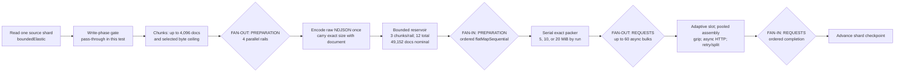

### Four rails with 1,024-document chunks

Run: S1-S1K.

### Four rails with 6,144-document chunks

Run: S1-L6K.

### Two rails with 4,096-document chunks

Runs: S1-P2 and S2-P2.

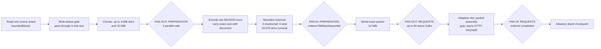

### Two rails with 1,024-document chunks

Run: S2-P2S1K.

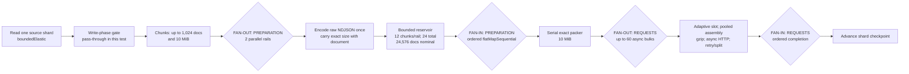

### Two rails with 6,144-document chunks

Run: S2-P2L6K.

## Interpretation

- The two-rail, 4,096-document configuration is the only candidate with a
  direct full-run replication. Its four-second spread is much smaller than
  the control's cross-screen variation.
- Reducing preparation from four rails to two also halved the nominal prepared
  reservoir from 49,152 to 24,576 documents. The two-rail runs nevertheless
  kept more request groups active than the clean control, so four preparation
  rails were not translating into more useful HTTP concurrency.
- Chunk size alone did not establish a decisive winner in the first screen.
  The 1,024-, 4,096-, and 6,144-document 10 MiB candidates completed within
  28 seconds.
- Combining two rails with 1,024-document chunks added scheduling and ordered
  fan-in pressure. It was slower and used more memory than the other
  second-screen candidates.
- Combining two rails with 6,144-document chunks produced the best
  steady-state throughput and CPU efficiency. Its 41-second full-run deficit
  to two rails with 4,096-document chunks occurred in the tail and needs a
  replicate before it can be treated as slower.
- Larger target requests were not automatically better. The 20 MiB run had
  approximately four times the 5 MiB request latency and substantially higher
  memory use without a meaningful completion advantage.
- No result was constrained by target rejection, adaptive slot availability,
  failed documents, or persistent target write queues. This screen isolates
  client pipeline scheduling and request production more cleanly than the
  constrained-target tests.

The conservative candidate is therefore two preparation rails with
4,096-document chunks and 10 MiB requests. The next useful experiment is a
multi-replicate comparison of that configuration against two rails with
6,144-document chunks, using the same isolated hardware and fresh target
indices.
