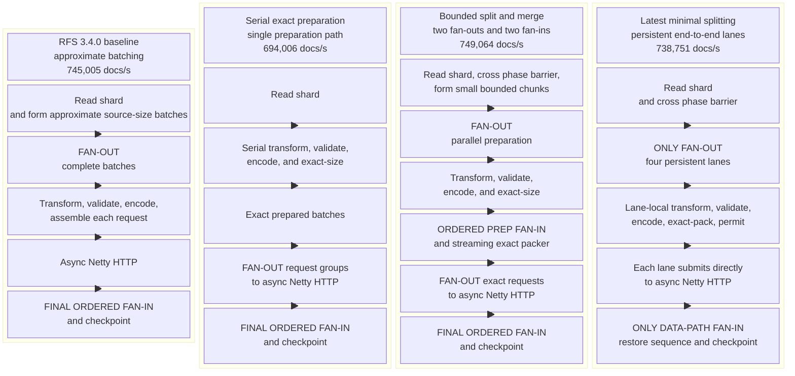

# RFS quick snapshot: selected pipeline shapes

Status: complete on 2026-11-06.

This is a deliberately narrow companion to
`RFS_QUICK_40M_PARALLEL_PIPELINE_COMPARISON.md`. It selects four structurally
different pipelines and keeps the same four runs next to one another in every
diagram, graph, and table.

The selected set includes:

- the RFS 3.4.0 performance baseline;
- the serial exact-preparation design;
- the fully instrumented bounded split-and-merge design; and
- P4-DJ, the latest minimal-splitting design with persistent lanes and no
  pre-Netty fan-in.

These are not four points along one tuning axis. They move preparation
parallelism, packing ownership, fan-out and fan-in placement, buffering, and
request-demand propagation in different combinations.

## Common test conditions

Every run migrated the same `rfs-quick-40m-v1` snapshot:

- 2,200,000,000 documents in 40 primary shards;
- approximately 543 GiB stored, with a largest shard of approximately
  13.64 GiB;
- 24 RFS workers on one isolated on-demand `c6id.24xlarge` host;
- 3300m CPU, 7000 MiB memory, and 100 GiB ephemeral storage per worker;
- a nominal 10 MiB and 20,000-document request ceiling with at most 60
  connections per worker;
- no transform;
- a 24-node `r6g.8xlarge.search` OpenSearch 2.19 target with 40,000 gp3 IOPS
  per node and no replica shards.

## Structural differences

| Decision | RFS 3.4.0 baseline | Serial exact preparation | Bounded split and merge | Latest minimal splitting |
|---|---|---|---|---|
| Run identity | Release `3.4.0`; `5d0e75376` | `0c99474e6` | `e3b8c370d` | P4-DJ; `755e0ac6e` |
| Commit time, UTC | 2026-10-16 01:53:14 | 2026-11-06 05:29:30 | 2026-11-06 06:25:38 | 2026-11-06 15:12:45 |
| Run window, UTC | 14:23:32–15:12:45 | 14:18:28–15:11:18 | 14:01:51–14:50:48 | 15:24:39–16:14:17 |
| Source unit | Approximate source-byte batch | Individual documents | Small bounded source chunks | Sequence-keyed source chunks |
| Transform, validate, encode | Inside each complete request publisher | Serial, before request fan-out | Parallel preparation rails | Four persistent end-to-end lanes |
| Request sizing | Approximate source-body size | Exact size after encoding | Exact streaming packer after preparation fan-in | Exact lane-local packer |
| First fan-out | Complete requests | Exact request groups | Preparation chunks | Source chunks into four lanes |
| Pre-Netty fan-in | None | None | Bounded ordered preparation fan-in | None |
| Second fan-out | None | Request groups to HTTP | Exact requests to HTTP | None |
| HTTP submission | One async publisher per approximate batch | After serial preparation and exact batching | After the global exact packer | Directly from each persistent lane |
| Final fan-in | Ordered request results | Ordered request results | Ordered request results | Unordered responses, then contiguous sequence restoration |
| Complete stage counters | No | No | Yes | Yes |

## All four pipeline shapes

The shared adaptive permit pool in P4-DJ is deliberately absent from the
solid data path. It gates each lane's request submission but does not merge,
order, buffer, or process lane data.

## Full-run performance

The completion time and accepted-document rate in the table below provide the
same full-run comparison without duplicating the evidence in a separate
chart.

| Result | RFS 3.4.0 baseline | Serial exact preparation | Bounded split and merge | Latest minimal splitting |
|---|---:|---:|---:|---:|
| Completion | 49m13s | 52m50s | 48m57s | 49m38s |
| Accepted documents/s | 745,005 | 694,006 | 749,064 | 738,751 |
| Rate versus 3.4.0 | Baseline | -6.85% | +0.54% | -0.84% |
| Completion difference | Baseline | +3m37s | -16s | +25s |
| Final target documents | 2,200,000,000 | 2,200,000,000 | 2,200,000,000 | 2,200,000,000 |
| Completed primary shards | 40/40 | 40/40 | 40/40 | 40/40 |
| Retained failed-document objects | 0 | 0 | 0 | 0 |
| Write rejections or breaker trips | 0 | 0 | 0 | 0 |

The serial design is the only selected shape with a clearly separated
full-run result: it is 6.85% slower than 3.4.0 and 7.34% slower than the
bounded design. The other three runs occupy a 1.38-percentage-point rate band.
That band is smaller than the 3.24% completion spread measured between two
identical P4-IM runs elsewhere in the experiment.

## What the new stage metrics add

The stage counters provide a conservation chain:

`source → prepared → ordered_prepared → packed → request_started → request_completed → checkpointed`

RFS 3.4.0 and the serial run predate the complete counter set, so the table
retains them explicitly as unavailable rather than inferring stage behavior
from later implementations.

| Pipeline-stage evidence | RFS 3.4.0 baseline | Serial exact preparation | Bounded split and merge | Latest minimal splitting |
|---|---:|---:|---:|---:|
| Complete counter coverage | No | No | Yes | Yes |
| Measurement window, UTC | — | — | 14:21:51–14:26:51 | 15:31:00–15:41:00 |
| `source`, documents/s | — | — | 884,655 | 885,160 |
| `prepared`, documents/s | — | — | 884,626 | 885,139 |
| `ordered_prepared`, documents/s | — | — | 884,626 | 885,139 |
| `packed`, documents/s | — | — | 884,742 | 885,276 |
| `request_started`, documents/s | — | — | 884,742 | 885,276 |
| `request_completed`, documents/s | — | — | 883,903 | 884,166 |
| `checkpointed`, documents/s | — | — | 884,091 | 884,044 |
| Full-chain rate span | — | — | 0.10% | 0.14% |
| Documents in active HTTP requests | — | — | Approximately 3.45M | Approximately 3.81M |
| Instrumented bottleneck found | Unobservable | Unobservable | No | No |

The bounded and direct shapes have nearly identical stage-chain rates, and
each keeps the maximum-to-minimum stage spread below 0.15%. Neither develops
a growing preparation, packing, request-ready, or checkpoint backlog in its
measured steady window. Most retained documents are in active HTTP requests,
which is expected for both.

This is the most useful role of the new metrics: they rule out an internal
transform, ordered-preparation, or exact-packing choke in the two modern
shapes. They do **not** prove that the intermediate fan-in is free, because
the selected commits also differ in lane ownership, buffering, demand
propagation, and shard assignment.

## Interpretation by decision

### Serial preparation

Moving transform, validation, encoding, and size annotation onto one serial
path is associated with the selected set's only material slowdown. The commit
also changes exact batching and demand propagation, so 6.85% is not a pure
measurement of one operator. It is sufficient evidence not to return to this
shape.

### Bounded split and merge

This shape gets preparation work onto multiple rails early and maintains
bounded inventory before one exact packer. It produced the fastest selected
full run, but only 0.54% more documents/s than 3.4.0 and 1.40% more than
P4-DJ. Those differences are too small to establish that either intermediate
fan-in or a second fan-out helps.

### Latest minimal splitting

P4-DJ keeps four lanes intact from preparation through request submission.
The only data-path fan-in is after Netty completes requests, where contiguous
checkpoint order must be restored. It is 0.84% slower than the 3.4.0 baseline
and therefore comfortably satisfies the no-more-than-8%-slower requirement.

The stage metrics show that its transform, exact-packing, and request
boundaries all sustain the same flow. Its fixed-window request production was
sometimes lower than the bounded shape, but matched-shard timing and complete
runs place that difference inside measured run-to-run variance.

### RFS 3.4.0

The baseline remains valuable as a performance reference, not as the desired
implementation. It batches against approximate source bytes rather than the
complete post-transformation NDJSON request, and it lacks the newer pipeline
stage evidence and target-aware safety behavior. Its nominally simpler shape
therefore does not preserve the same correctness and observability contract.

## Selected conclusion

Of these four deliberately different strategies:

1. do not use the serial exact-preparation shape;
2. treat the bounded split-and-merge and direct persistent-lane shapes as
   performance-equivalent on this snapshot and hardware; and
3. prefer P4-DJ when minimizing pipeline splitting and pre-Netty coordination
   is the design goal.

P4-DJ is not selected because it won a noisy benchmark. It is selected because
it keeps the intended one-fan-out/one-final-fan-in structure, preserves exact
sizing and safety behavior, has no instrumented internal bottleneck, and
finished only 0.84% behind RFS 3.4.0.
