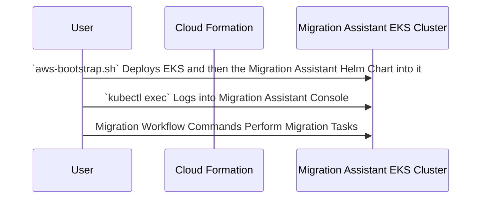

# AWS Solutions Deployment

OpenSearch Migration assistant is distributed in AWS Solutions Library, see the most recent release in https://aws.amazon.com/solutions/implementations/migration-assistant-for-amazon-opensearch-service/

## Architecture

A user deploys an
EKS cluster via one of the vended CloudFormation templates.  Once deployed, the
user runs the migration-assistant CLI (legacy entry-point: `aws-bootstrap.sh`,
which is now a thin shim that execs the CLI with the same flags). The CLI can
be downloaded directly from GitHub and run as-is. Both of these commands can be
run from an AWS CloudShell or from anywhere else with credentials and network
access.  

See [here](../k8s/aws/README.md) for a quick-start to setup and EKS cluster 
and deploy the Migration Assistant to it.

## Development

The CloudFormation project is written in TypeScript and uses the AWS Cloud
Development Kit (CDK) to synthesize the EKS deployment templates.

### Quick Start Guide

* Install Node 18+ & Npm 10+ https://docs.npmjs.com/downloading-and-installing-node-js-and-npm
* Build the project `npm run build`
* Test the project `npm run build`
* Create the deployment artifacts `npm run synth`
* Deploy with the default AWS credentials to the default region `npm run deploy`
