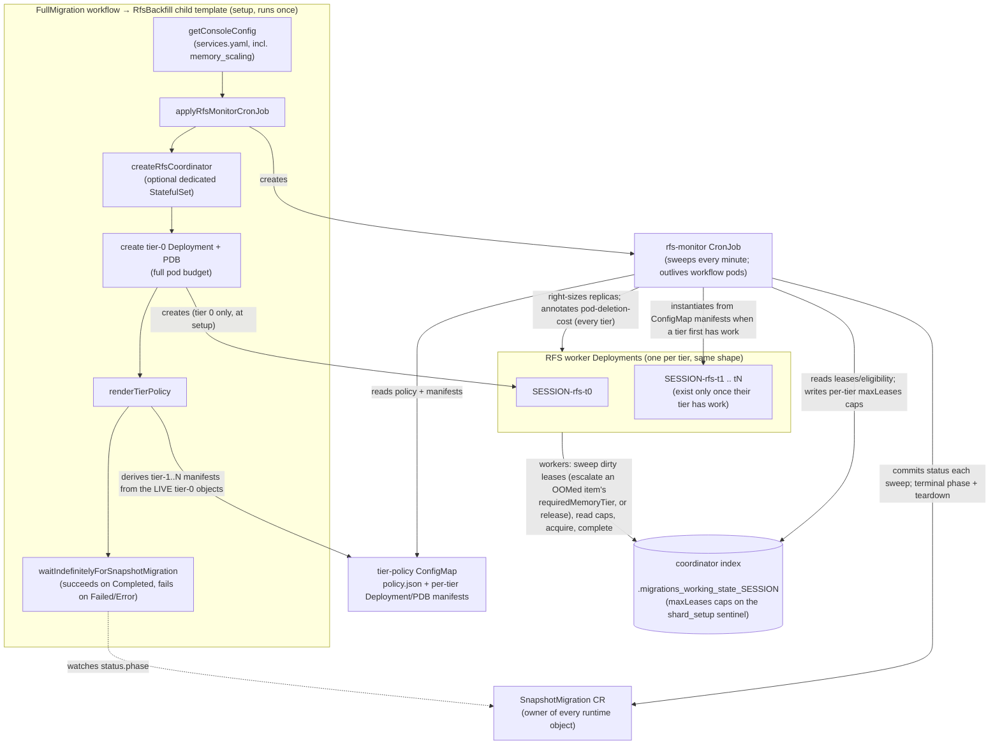
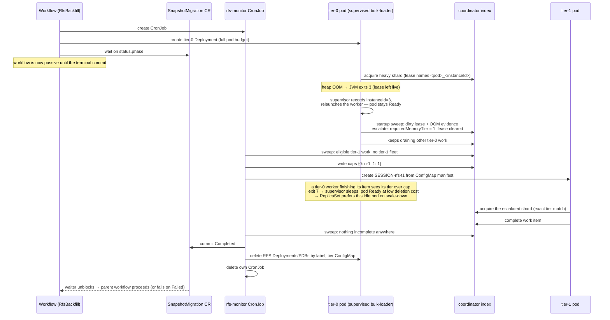

# Design Doc: RFS Crash Escalation and Memory-Tier Scaling

**Status:** implemented

**Date:** 2026-11-19 (implementation 2026-11-20)

## Objective

Retry a shard that runs out of memory on a larger worker while the rest of the fleet keeps
migrating. `memoryScaling` defines a geometric progression from the starting memory request to
`maxMemory`. The monitor can fund a higher tier as soon as it has work. Waiting for an entire
lower tier to drain would delay long-running shards at every tier boundary. If the largest
worker still runs out of memory, the migration reports the affected indices and shards.

Three constraints shape this design. Escalation requires positive OOM evidence, since increasing
memory for a native bug or a poison document wastes capacity. Evidence must survive a container
restart and identify the launch that held the lease. Finally, `maxTotalPods` limits concurrent
workers across tiers to control target load. Each worker receives its tier as an integer and
can process shards without inspecting its memory allocation.

## Background

- **Work coordination.** In `.migrations_working_state_<session>`, `expiration` (epoch seconds,
  zero when unclaimed), `leaseHolderId` and `completedAt` govern ownership. Acquisition uses an
  atomic `_update_by_query`. `successor_items` links continuations and the acquisition lease
  exponents control retry duration. Extending a lease alone cannot help a shard that needs more RAM.
- **Worker identity.** The pod name survives a container restart. Each JVM appends a fresh UUID
  or a supervisor-issued launch ID. `getAssignedWorkItemUnsafe` relies on each holder identifying
  a single launch and its lease.
- **Heap sizing.** `-XX:MaxRAMPercentage=80.0` scales the heap with the container limit. Keep
  `-Xmx` out of `jvmArgs` to preserve this behavior. `-XX:+ExitOnOutOfMemoryError` produces exit
  3 for heap OOM. The supervisor also handles cgroup kills and library-raised OOMs below.
- **Fleet runtime.** Argo creates the worker Deployment and waits on the `SnapshotMigration` CR.
  The per-minute monitor runs `console backfill status --deep-check`, commits status, and removes
  the runtime at completion. Its `argo-workflow-executor` service account can read pods and manage
  Deployments. [RFS monitor lifecycle](rfsCronJobMonitor.md)

## Design overview

| Role | Component | Responsibility |
| --- | --- | --- |
| Supervisor + crash recorder | in-container wrapper script (PID 1 of each RFS container) | relaunch the worker in place (pod stays Ready through recovery); record *why* each launch died |
| Kernel-OOM witness | monitor (same sweep) | record the one death the supervisor cannot (cgroup group kill), via a pod annotation |
| Detector + marker | RFS java, startup sweep | find *that* a predecessor died holding work; escalate or recover the item |
| Work router | RFS java, acquire protocol | exact-tier matching + yield to higher tiers |
| Scheduler | monitor CronJob | per-sweep fleet sizing, tier activation/reactivation, budget arbitration, terminal status |
| Policy author | Argo workflow / config processor | render the per-tier manifests and the tier table once, up front |

The [orchestration diagrams](#orchestration) trace one shard from its first OOM to completion on
another tier. The supervisor records the crash, the next worker changes the shard's required
tier, and the monitor allocates a worker that can acquire it.

## Work-item schema additions

Coordination scripts require `scriptVersion` 3.2, up from 3.1, and reject documents from a
different version. Finish existing migrations before upgrading.

| Field | Written by | Meaning |
| --- | --- | --- |
| `requiredMemoryTier` (int, absent ⇒ 0) | escalation script | exact tier whose workers may acquire this item |
| `leaseAcquiredAt` (epoch seconds) | acquire scripts | when the current lease was taken (diagnostics; crash attribution itself is by the holder's instance id, not time) |
| `leaseAbandoned` (bool, absent ⇒ false) | deliberate-abandon path | lease was left to expire on purpose; the sweep must not treat it as a crash. **Cleared atomically by the next acquisition** (and by the escalation/release scripts) — a sticky flag would permanently mask later hard crashes on the same item |

Successor items inherit the predecessor's `requiredMemoryTier` (the worker creating them passes
its own tier through).

## RFS worker changes

### New arguments

The tier arrives via the existing `RFS_` env-var injection, set on the Deployment pod template;
the per-launch arguments are passed on the command line by the in-container supervisor
(`runJavaWithClasspathWithRepeat.sh`), which relaunches the worker JVM in place:

```
--worker-memory-tier <int>        RFS_WORKER_MEMORY_TIER   default 0 (env; also switches the
                                                           wrapper into its supervised loop)
--worker-instance-id <id>         per launch, from the supervisor: <containerStartEpoch>-<launchN>.
                                  The worker id becomes <podName>_<instanceId>, so every lease
                                  names exactly the launch that held it.
--predecessor-crashes <id>=<outcome>[,...]
                                  how recent launches in this container died (exit code, or
                                  "OOMKilled"); the startup sweep's evidence. Absent → every
                                  dirty lease is release-only.
--sweep-only                      run the startup sweep and exit 0 (the supervisor uses this on
                                  SIGTERM when a crash has not been swept yet)
```

### Exit codes

| Condition | Code | Supervisor policy (feature on) |
| --- | --- | --- |
| work item completed | 0 | relaunch now (`completedAt` stamped — never again acquirable) |
| unhandled error (uncaught exception) | 1 | record crash, relaunch (backoff after repeated short-lived crashes) |
| lease timeout (successors created) | 2 | relaunch now |
| out of memory | 3 | record as OOM, relaunch now. Heap/metaspace via `-XX:+ExitOnOutOfMemoryError`; an `OutOfMemoryError` raised from library code (e.g. the direct-buffer limit) reaches the same exit through the fatal-error policy (`FatalErrors`: uncaught handler, `Hooks.onErrorDropped`, and the HTTP/retry boundaries — reactive failures travel the onError channel, where a retry operator would otherwise swallow them) |
| work exists, none eligible for me | 4 | sleep 15–30 s, relaunch |
| non-retriable snapshot read failure | 5 | record crash, relaunch (pre-existing code; aligned with the metadata command) |
| no work left anywhere (drained) | 6 | sleep 60–90 s, relaunch. **Was 3** — renumbered to free 3 for OOM |
| own tier over its lease cap | 7 | sleep 15–30 s, relaunch. The pod stays Ready while it idles; the monitor's pod-deletion-cost, not readiness, marks it as the scale-down victim |
| non-OOM `java.lang.Error` (LinkageError, AssertionError, …) | 8 (new) | record crash, relaunch. Fail-fast like an OOM, but the sweep must *release*, never escalate — a deterministic non-memory crash must not climb the memory ladder |
| SIGKILL of the worker | 137 | ambiguous alone; recorded as OOM only when the container cgroup's `oom_kill` counter rose (the non-k8s witness). Under cgroup v2's default `memory.oom.group=1` a kernel OOM kills the supervisor too — see "Kernel-OOM witness" |

Nothing outside the container consumes the old codes, so renumbering is contract-internal.
With the feature off (`RFS_WORKER_MEMORY_TIER` unset) the wrapper keeps its original behavior:
relaunch on 0, exit otherwise, kubelet restarts the container.

### Dirty-lease sweep (startup, before any acquisition)

```
dirty = search( prefix(leaseHolderId, podName + "_")
                AND leaseHolderId != myWorkerId
                AND NOT exists(completedAt)
                AND expiration > now
                AND NOT leaseAbandoned )
for each dirty lease:
    outcome = predecessorCrashes[ instanceIdOf(lease.leaseHolderId) ]   # exact, no timestamps
    if outcome is "3" or "OOMKilled":
        escalate: requiredMemoryTier = max(current, myTier + 1)
                    nextAcquisitionLeaseExponent = acquisitionLeaseExponent   # tier ≠ time
                    expiration = 0; leaseHolderId = null
    else (any other outcome, or holder not in the list):
        release only (same fields cleared, tier untouched)
```

Properties:

- **Race-free trigger.** Every benign exit path (completion, successor creation, timeout, SIGTERM
  hook, uncaught exception — a normal JVM exit runs shutdown hooks) destroys or transfers its
  lease first. Only hard kills (heap OOM bypasses hooks via `os::_exit`, cgroup SIGKILL, JVM
  native crash) leave a live lease behind. First starts and clean restarts find nothing.
- **Exact attribution.** The lease names its holder as `<podName>_<instanceId>` and the
  supervisor reports crashes by the same instance id, so classification is a map lookup — no
  clock comparison, no skew window, no polling, and no way to attach a verdict to the wrong
  lease.
- **Conservative default.** No OOM evidence → no tier bump. A real OOM recurs and gets attributed
  on a later round; a transient crash just gets its lease back immediately (an improvement over
  today's wait-for-expiry, and deliberately kept even though crashes are rare).
- **Idempotent.** The escalation script guards on the observed `leaseHolderId` and no-ops if the
  lease moved; clearing the lease means a second look finds nothing.
- The `leaseHolderId != myWorkerId` clause is an invariant, not a live filter: the sweep runs
  before any acquisition and the instance id is minted per launch, so it can never match today.
  It keeps the sweep safe against its own live lease if it is ever re-run mid-process (the
  planned in-java acquire loop would do exactly that).
- **SIGTERM cover.** The worker's shutdown hook finishes a startup sweep that had not completed,
  and if SIGTERM lands between a crash and the next launch, the supervisor runs one `--sweep-only`
  worker before exiting — so recorded evidence is never lost to a scale-down.
- The escalation update is a painless scripted `_update` like every other coordinator mutation —
  version conflicts surface as 409s and retry, consistent with the existing client.
- The deliberate-abandon path (failed-document-stream flush failure at shutdown,
  `RfsMigrateDocuments.flushFailedDocumentStreamBeforeComplete`) runs live pre-exit code; it
  gains one write setting `leaseAbandoned: true` so the sweep skips it.

### Acquire protocol

A worker checks its tier at every item boundary. This keeps small shards on small workers and
lets a saturated lower tier release capacity while its workers finish their current shards.

1. A `_search` counts incomplete items by `requiredMemoryTier`, including the waiting count
   (`expiration < now`) within each tier. Live leases at the worker's tier equal that tier's
   total minus its waiting count. The response's overall hit count tells the worker whether the
   migration has drained.
2. If any work remains, the worker reads `maxLeases[myTier]` from the session's `shard_setup`
   document. The monitor publishes all tier caps there each sweep. A missing document, field,
   or tier entry leaves that tier uncapped.
3. The worker applies the first matching rule below. A successful acquisition uses the existing
   atomic `_update_by_query` with an exact-tier clause and random ordering, followed by a search
   for the lease it won.

| Condition | Action |
| --- | --- |
| No incomplete items anywhere | Exit 6 (drained) |
| Own tier has a cap and its live leases meet or exceed it | Exit 7 (yield) |
| Own tier has waiting work | Attempt acquisition |
| All remaining work is leased or belongs to another tier | Exit 4 (idle) |

New items can omit `requiredMemoryTier`. Tier 0 therefore matches either an explicit zero or a
missing field, and the aggregation uses `"missing": 0`. Other tiers match their integer value.

A cap reduction takes effect as workers finish. For example, reducing tier 0 from 24 leases
to 21 lets three workers yield at item boundaries. Two workers can both acquire as the count
crosses a cap. The next finisher observes the excess and yields. A monitor outage leaves the
last published caps in effect until another sweep updates them.

The census and cap read add at most two requests to the existing lease update and readback.
The Painless update script sees only its own document, so it cannot count peer leases. Fetching
an item to inspect its tier after acquisition would already have leased it. Sorting higher tiers
first and treating mismatches as no-ops would depend on `_update_by_query` sort and `max_docs`
behavior across ES 6.8 and OpenSearch 1–3. It could also make an entire lower tier yield for a
single escalated shard. Per-tier caps allow the remaining workers to continue.

## In-container supervisor

`runJavaWithClasspathWithRepeat.sh` (PID 1 of the bulk-loader container) becomes a supervisor
when `RFS_WORKER_MEMORY_TIER` is set: it relaunches the worker JVM in place per the exit-code
policy table above and **never exits on its own**, so the container keeps running and the pod
stays Ready while a worker recovers from a crash. That is the load-bearing property: a
ReplicaSet scale-down ranks victims by readiness *before* pod-deletion-cost, so a pod that
flipped not-ready at the instant of an OOM would be culled mid-recovery regardless of the
monitor's annotations. Keeping the pod Ready lets the monitor protect a recovering lease holder
by assigning it a high deletion cost.

Per launch, the supervisor mints `--worker-instance-id <containerStartEpoch>-<launchN>` and
passes the recent crashes as `--predecessor-crashes` (last 5, `<instanceId>=<exit code or
OOMKilled>`), giving the sweep its exact-attribution evidence. The worker's own memory flags are
untouched: heap stays at `MaxRAMPercentage=80`, and no metaspace/direct caps are imposed —
artificially low caps could force a shard to climb several tiers to satisfy a limit it never
actually needed, so the design prefers an occasional kernel OOM (witnessed below) over
miscategorized escalations.

Two optional environment hooks, both plain files so the script stays environment-agnostic:

- `RFS_STATE_DIR` — a directory that outlives the supervisor but not the pod (an `emptyDir` in
  k8s). Holds the crash list and an **open-launch ledger** entry written before each launch and
  closed with its outcome; an open entry at supervisor startup means the whole container died
  abruptly (the kernel-OOM case).
- `RFS_CRASH_EVIDENCE_FILE` — a file an outside witness maintains with the same
  `<instanceId>=<outcome>` entries, merged into the crash list before every launch.

### Kernel-OOM witness (the monitor)

Under cgroup v2's default `memory.oom.group=1` (k8s ≥1.28 behavior, verified empirically), a
kernel OOM kills **every** process in the container — supervisor included — so no in-container
code can record it; the kubelet restarts the container and the evidence would die with it. The
witness is the component that already watches the fleet:

1. The monitor's pod LIST (which it already performs each sweep) carries
   `lastState.terminated.reason == OOMKilled` with the dead container's `startedAt`/`finishedAt`.
2. The monitor matches the pod name in the shard lease's holder ID (`<podName>_<instanceId>`)
   to the pod reporting the OOM. It checks that the instance timestamp falls within the
   terminated container's lifetime, allowing for a small skew at startup.
3. On that same worker pod, the monitor appends `<instanceId>=OOMKilled` to the
   `migrations.opensearch.org/rfs-predecessor-crashes` annotation. It keeps the eight most
   recent entries and skips the PATCH when the evidence is already present.
4. The kubelet projects the updated annotation into `RFS_CRASH_EVIDENCE_FILE` in the
   restarted container on that pod.
5. The restarted supervisor finds the open ledger entry with no outcome and **waits bounded**
   (`RFS_EVIDENCE_WAIT_SECONDS`, default 120 s — one monitor tick plus downward-API propagation)
   for the file to name that instance before launching, so the first post-OOM sweep escalates
   instead of releasing blind. The wait ends early the moment the evidence appears; if it never
   does (e.g. the container was SIGKILLed by something other than the kernel, where no OOMKilled
   record exists), launching with no evidence is the correct outcome — release at the same tier.

The monitor writes the pod annotation and the fleet caps on `shard_setup`. Workers own changes
to individual shards' leases and required tiers. If the monitor is unavailable or the annotation
arrives after the bounded wait, the worker releases the shard for a same-tier retry. JVM-raised
OOMs use the supervisor's local evidence and can escalate while the monitor is unavailable.

Outside k8s (docker/local), there is no monitor: the supervisor's cgroup `oom_kill`-counter check
on a 137 is the kernel-OOM witness there (single-process kills; without `oom.group` the wrapper
survives).

**Rejected alternatives.** A per-pod sidecar witness (an earlier draft of this design) writes the
same evidence with lower latency, but costs an extra container on every one of hundreds of worker
pods, its own RBAC and image pulls, and still cannot keep the pod Ready through a worker crash —
the supervisor was needed anyway, at which point the fleet-wide monitor covers the rare kernel-OOM
case for free. Lowering the supervisor's `oom_score_adj` to −1000 (so it survives the group kill
and records the evidence itself) works — verified with `CAP_SYS_RESOURCE` granted — but the
capability is outside the Pod Security "baseline" profile and protecting a process from the OOM
killer in a memory-stressed container was judged imprudent; it remains possible as a purely
optional hardening since the write degrades gracefully to a no-op without the capability.

## Fleet management

### One Deployment per tier

Each tier needs its own Deployment (`<session>-rfs-t<n>`) and PodDisruptionBudget because its
pod template sets a different memory quantity and `RFS_WORKER_MEMORY_TIER`. Include the tier in
the immutable Deployment selector, pod labels and PDB selector so controllers have disjoint
sets of pods. The monitor selects the whole fleet by component and migration UID. The console
reads each configured tier's Deployment by name when it builds worker counts.

### Budget and allocation (monitor, every sweep)

`maxTotalPods` is the fleet-wide cap, pod-count-denominated because per-pod throughput to the
target is memory-independent. There is no native k8s construct for "max pods across a set of
Deployments" (annotation-counted quotas do not exist; `ResourceQuota` is namespace-wide, blunt,
and priority-blind — usable only as an optional defense-in-depth backstop), so the monitor's
arithmetic is the mechanism — and it must exist anyway to express priority:

```
per sweep:
  busy[t]     = DISTINCT RUNNING pods of tier t named in live leases (a lease whose holder pod
                is gone or terminating is a GHOST. It still occupies a lease slot, so it is
                added to the tier's published cap and subtracted from its demand)
  eligible[t] = incomplete items at tier t
  precedence (highest wins when the budget cannot satisfy all three):
    1. busy floor: never set replicas[t] below busy[t] — inviolable
    2. higher-tier demand, tier-descending: each tier gets min(eligible[t], remaining budget)
    3. discovery floor: >= 1 pod for the lowest tier with never-attempted items, funded only
       from budget left after (2) — greedy wins over discovery when they conflict
       (deep chains are revealed by attempts, so keep discovery alive whenever budget allows)
  publish: write the resulting per-tier allocation as maxLeases caps on the shard_setup sentinel
           (see acquire protocol); pods owed to higher tiers drain from lower ones as workers
           hit item boundaries and find their tier over-cap — never by deleting a busy pod
  trim: for over-allocated tiers, annotate idle pods (replicas - busy) with low
        controller.kubernetes.io/pod-deletion-cost, busy pods with high, then
        patch replicas = busy + kept-idle — in that order, same sweep
  reactivate: eligible work at a tier with no fleet → create its Deployment from the
              pre-rendered manifest (replicas = min(eligible, available budget))
  bootstrap: level 0 starts at the FULL pod budget (maxTotalPods) — workers self-coordinate
             through the coordination index as they always have, and node provisioning overlaps
             shard setup instead of trailing the first sweep. Until the shard_setup sentinel
             completes the monitor LAYS OFF entirely (no caps, no trims, no creates): item
             counts are meaningless before work items exist, and acting on them would cull the
             fleet mid-setup. The first post-setup sweep right-sizes to min(eligible, budget).
  metrics: each sweep emits its per-tier truth (cap, desired replicas, busy, ghosts, eligible,
           waiting) as fleetMonitor-scope gauges through the OTel collector for scheduler investigations
```

Rebalancing is **attrition-based**: budget moves to higher tiers only as lower-tier pods actually
go idle (which the lowered cap guarantees as each worker reaches its next item boundary).
If a tier has no idle pods, the monitor waits — it never deletes a lease-holding pod.

### Culling the right pod

ReplicaSet downscale victim ranking: unscheduled → pending → **not-ready** → **lower
pod-deletion-cost** → shorter ready time → more restarts → newer. There is no pluggable policy
hook. Because the in-container supervisor keeps every pod Ready — through crashes, OOM recovery,
and idle sleeps alike — the not-ready rung never differentiates RFS pods, and victim selection
rests on `pod-deletion-cost`:

1. The monitor sets `pod-deletion-cost` from lease truth (busy high, idle low, only values that
   changed) immediately before each scale patch, with a short pause so the ReplicaSet's cache
   sees the costs before choosing victims.
2. An idle (over-cap / no-work) worker is a sleeping supervisor, not a crash-looping container —
   its pod stays Ready with a low deletion cost, so the ReplicaSet prefers it for scale-down.

Residual race: a pod judged idle grabs work in the instant before deletion → SIGTERM → existing
clean-shutdown hook checkpoints or releases → cost ≈ one lease round-trip. The inverse
(undercounted idle) delays rebalance by one sweep. PDBs do not protect against scale-down
(it is not an eviction), crashloop restarts alone never remove a pod, and no min/max field exists
on Deployments — the monitor's floor rule is the only guard, by design.

`pod-deletion-cost` is a documented *preference*, not a contract — the design must stay correct
if the ReplicaSet deletes a busy pod anyway. It does, by degradation: SIGTERM → clean shutdown
checkpoints/releases (fine); if shutdown overruns and is force-killed, the pod never restarts (it
was deleted, so no same-pod sweep runs) and the lease expires naturally — the pre-existing safety
net; one delayed retry, no lost work. To make the overrun rare, RFS pods set
`terminationGracePeriodSeconds` comfortably above the shutdown path's worst case (failed-document
flush is bounded at 5 min, so e.g. 390 s), and the wrapper's internal 30 s SIGKILL fallback rises
to match.

Known lag: a yielded pod the monitor keeps re-checks at the supervisor's idle cadence (15–30 s
sleeps for over-cap/no-work, 60–90 s when the queue looks drained), so lower-tier resumption
after a higher tier claims its items can trail by under a minute. Acceptable at sweep
granularity; the in-java acquire loop removes it later.

## Orchestration

1. The config processor computes `[start, start × factor, …, maxMemory]`, clamping the last tier
   to the exact maximum. This keeps Kubernetes quantity arithmetic in `resolveMemoryScalingTierTable`.
2. The workflow installs the monitor and creates tier 0 at the full pod budget. Once tier 0 exists,
   `renderRfsTierPolicy.sh` reads its live Deployment and PDB. `deriveRfsTierManifest.jq` changes
   the name, tier selectors and labels, memory, environment and initial replicas for each higher
   tier. The workflow stores those manifests and `maxTotalPods` in the policy ConfigMap and waits
   on the `SnapshotMigration` CR. The CR owns the runtime objects.
3. The monitor creates higher tiers from the policy when they first have work, reconciles replicas,
   and commits terminal status before teardown. A `CompletedWithErrors` backfill retains its
   failed-document details under a `Completed` CR phase. When only above-maximum shards remain
   and none are in progress, the console produces a per-index rollup and the monitor commits
   `Failed`. The workflow waiter propagates that failure. [Failed document stream](failedDocumentStream.md)

The configured memory range and pod budget authorize escalation throughout the run. Nodepool
instance-type and capacity limits determine what can actually schedule. An operator can adjust
those limits during a run and see unschedulable pods in `workers.pending`. EC2 spend depends on
the nodes provisioned and their runtime. A fleet-wide escalation storm is discussed in Future work.



One shard's escalation while the workflow waits on the CR follows below.



### User configuration (`documentBackfillConfig`)

```yaml
resources: { requests: { memory: 7000Mi, ... } }   # starting size (existing field)
memoryScaling:                                     # NEW; absent ⇒ feature entirely off
  growthFactor: 2            # expert, default 2
  maxMemory: "56000Mi"       # required; caps the tier table
maxTotalPods: 24             # replaces podReplicas semantics when memoryScaling is set:
                             # a TOTAL across all tiers, and a maximum, not a constant
```

Constraints and operational notes:

- `growthFactor` has a schema floor of **1.1** (not merely > 1), so a pathological factor cannot
  create thousands of tiers.
- `maxTotalPods` defaults to `podReplicas` when `memoryScaling` is set without it (one knob for
  the common case); `maxTotalPods` without `memoryScaling` is a validation error.
- `console backfill scale` is **not supported** while `memoryScaling` is on: the monitor rewrites
  per-tier replicas every sweep from `maxTotalPods`, so a direct replica patch would be
  overwritten within a minute. The supported knob is the `maxTotalPods` config value.

Each tier sets `requests.memory` and `limits.memory` to the same value so scheduling and heap
sizing use the same memory budget. CPU requests and limits carry over from the base `resources`.

With `memoryScaling` absent, the Kubernetes workflow uses the original Deployment name, pod
configuration and console status shape. Workers use tier 0. The acquisition census accepts
items with a missing tier, and the absence of published caps leaves acquisition unlimited.

## Console and CR status

The console includes the following fields when `memoryScaling` is configured.

- `shard_awaiting_memory` — incomplete items whose tier exceeds every active fleet's tier.
  `shard_waiting` keeps its exact current meaning (eligible-and-unclaimed), so existing
  consumers' semantics hold and `total = complete + in_progress + waiting + awaiting_memory`.
- `workers: {desired, running, pending}` per the deployment set — surfaced so "escalated but pods
  unschedulable" (no node fits the new size; Karpenter/EKS Auto Mode usually self-heals) is
  distinguishable from "running".
- `memory_scaling: {tiers: [...], active: [{tier, replicas, busy}], ...}` for observability.
- Terminal `Failed` carries the rollup, aggregated per index (successors share their original shard number, so a
  completed parent with a failed successor still counts as one incomplete shard. For older items
  without `indexName`, the console decodes the base64url `_id`):

```json
{
  "status": "Failed",
  "message": "3 shards still exceed maxMemory (56000Mi) at tier 3",
  "indices": {
    "succeeded": ["logs-2024-01", "logs-2024-03", "orders"],
    "incomplete": [
      {"index": "logs-2024-02", "shards_complete": 14, "shards_total": 16,
       "shards_exceeding_max_memory": [3, 7]}
    ]
  }
}
```

## Metrics and dashboards

### What the fleet used

Read CPU and memory alongside source documents processed per second. Each colored band shows one tier's
CPU consumption in cores or sampled container working set in GiB. The gray band shows the portion
of running containers’ limits above measured usage. It includes the full limit of any worker whose
usage reading is missing. A worker measured above its own limit contributes zero to the gray band
and its full measured usage to its tier. A pending worker starts contributing once its bulk-loader
container runs. Workers from different migrations can have different limits at the same
tier, so each running worker contributes its own configured limit. Workers without memory scaling
contribute to tier 0.

CPU requests influence placement. EC2 cost depends on which nodes run and for how long. On the
memory chart, a large gray band can coexist with an OOM in one worker. Grafana's hottest-pod
panels compare each running pod with its own limit. Working-set samples can miss a brief peak.
Use the OOM evidence and the shard's `requiredMemoryTier` to investigate an escalation.

On EKS the resource sampler lists running bulk-loader containers every 15 seconds and reads CPU
and working set from the kubelets hosting them. It matches the pod UID, container, and sample time
before summing by tier. CloudWatch plots the mean of each minute’s successful censuses. A worker
observed in one of four successful censuses contributes one quarter of its observation to that minute.
An empty census contributes zero. During partial coverage the colored bands sum only the workers
with fresh readings. A failed pod list contributes no observation. The sampling panel shows how
many censuses succeeded and how many workers were awaiting each measurement. Resource series begin
at rollout, and new tiers appear when first observed. For a self-managed target, set
`metrics.cloudWatch.showManagedTargetDomain` to `false` to hide the managed-service panels.
Grafana computes CPU independently from the rate of `container_cpu_usage_seconds_total`, joined
with the running pod and its tier.

### Investigating a move to a higher tier

**Workers by memory tier** shows how many running workers used each tier. It sits next to fleet memory
in **Throughput and worker resources**. A run that stays at its starting size uses only tier 0.

For a run that climbs the ladder, `workItemsEscalated` counts applied moves by destination tier.
One item can move several times. The applied-action logs identify the items and can reconcile counts
when a worker or collector exits before export. The coordination index retains the resulting
`requiredMemoryTier` on each completed item.

For the scheduler's view, inspect the `fleetMonitor` events in the `rfs-tier` stream of the
`/metrics/OpenSearchMigrations` log group. `tierEligibleItems` includes waiting and in-progress items.
Use the latest check per migration and tier in each minute when comparing counts. The sweep log
also records busy workers, lease caps and requested replicas. The workflow records final completion.

### Validating "Culling the right pod"

The decision to trust `pod-deletion-cost` ranking (a preference, not a contract) is checkable
because the monitor already holds both sides of the truth — leases and pods:

- **Busy-cull count — the metric that must stay ~0.** A pod that was in the busy set (named in a
  live lease) and is gone from the pod list one sweep later, without its item completing, was
  culled while working. Derivable today by joining consecutive sweep logs with the ReplicaSet's
  `SuccessfulDelete` events (which distinguish culls from crashes). For a nonzero count, check
  the deletion-cost map in the same sweep's log to see which costs the monitor assigned.
- **Cull cost when it does happen**: for a culled pod's item, the gap between the cull and the
  item's next `leaseAcquiredAt`. Roughly zero means the clean-shutdown hook released the lease
  (the designed degradation — one round-trip); a gap near the remaining lease duration means the
  shutdown overran its 390 s grace and the lease expired naturally — the signal to revisit the
  grace budget.
- **Attrition latency** measures the sweeps from a cap reduction until `replicas == desired` on
  that tier. Compare the sweep logs with the live leases to see which shards held workers busy.

## Testing

- **Unit (java):** sweep classification table (predecessor outcome × escalate/release, including
  bare 137, exit 8, and holder-not-reported); crash-list parsing; fatal-error policy (OOME
  anywhere in a cause chain → 3, other Errors → 8, exceptions pass through); escalation script
  guards and idempotence; acquire protocol decision table (drain / yield / acquire / idle); tier
  inheritance on successors; exit codes.
- **Supervisor checks against the real image:** exit-code policy matrix, crash-list trimming
  and per-launch CLI args, ledger persistence across a simulated group kill, bounded evidence
  wait with early exit, sweep-only on SIGTERM, feature-off loop unchanged.
- **Unit (console):** new classification buckets; gating (feature-off output byte-identical);
  terminal rollup aggregation.
- **Templates (jest, orchestrationSpecs):** per-tier manifest rendering (state/evidence volumes,
  no sidecar), tier-table computation and clamping, monitor arithmetic fixtures (allocation,
  ghost leases, deletion costs, kernel-OOM witness matching), feature-off no-op.
- **Integration.** Cases 0090–0095 cover escalation to completion, exhaustion with a per-index
  failure report, a bare SIGKILL (137) that releases at the same tier, the ordinary single
  Deployment, a multi-tier migration, and the kernel-OOM witness. A transformer makes a
  deterministic allocation on the first document of each weighted index to force the intended
  heap OOM. These cases run on explicit selection. [Integration cases](../migrationConsole/lib/integ_test/integ_test/test_cases/memory_tier_scaling_tests.py)

## Future work (deliberately out of v1)

- **Within-tier successor preference.** The acquire stays `random_score` within a tier;
  preferring a crashed shard's own successors would shorten chains slightly, but the discovery
  floor plus greedy tier-descending budget already covers chain continuity.
- **Live `maxTotalPods` override.** Today the budget is a config value; surfacing a runtime
  override through the monitor (so `backfill scale` could work again) is future work.
- **In-Java acquire loop** folds the supervisor's relaunch loop into
  the JVM (one process takes item after item) and turns yield into an in-process capped sleep;
  also removes the yielded-pod resumption lag. The shell supervisor must remain for crash
  isolation — a JVM that OOMed cannot be trusted to continue — but would launch far less often.
- **Escalation-storm guard**: alert (or pause further tier activation) when > N% of remaining
  shards escalate within one tier — that pattern smells like a leak, not fat shards.
- **Explicit `busyCulled` sweep log line.** Operators can reconstruct a busy cull from sweep logs
  and Kubernetes deletion events. A dedicated event would make that investigation faster.
