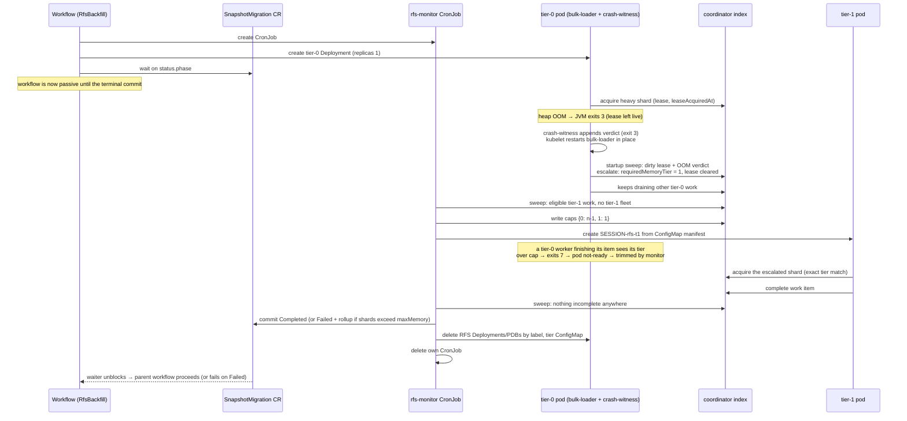

# Design Doc: RFS Crash Escalation and Memory-Tier Scaling

**Status:** implemented

**Date:** 2026-11-19 (implementation 2026-11-20)

## Objective

When an RFS worker is killed by an out-of-memory condition while migrating a shard, escalate
that shard's work item so the current fleet stops retrying it, and run the escalated shard on a
fleet with more memory. Escalation is **eager (greedy)**: as soon as an escalated shard sits
unclaimed at a higher tier, pod budget shifts to run it there while the remaining lower-tier work
continues in parallel — tiers are not sequential passes (lockstep passes were considered and
dropped: they add idle bubbles at every pass tail and chop deep chains across barrier waits for
no pod-hour savings, since every item must be attempted at tiers 0..T anyway). Memory grows
geometrically per tier from a user-configured starting size, by a user-configured factor
(default 2), up to a user-configured maximum. If shards still fail at the maximum, the migration
fails with a report naming which indices completed and which did not.

Secondary objectives shaped the design:

- The RFS image must never inspect its own memory. It receives one opaque integer (its tier) and
  otherwise stays memory-unaware, keeping it eligible to become distroless.
- Non-memory crashes must never climb the memory ladder. A fleet-wide crasher (native bug, poison
  document) at 2×, 4×, 8× memory would multiply the run's cost for nothing, so a tier bump
  requires positive OOM evidence.
- Crash detection must not depend on winning races against restarts or polling windows. Losing
  evidence to a node crash is acceptable; losing it to timing is not.
- Pod count is the throughput budget. The user's constraint is load on the target cluster, which
  is per-pod and memory-independent, so the fleet-wide cap is a **total pod count across all
  tiers**, and no tier may run more pods than it has work for.

## Background: the pieces this builds on

- **Work coordination.** Work items are docs in `.migrations_working_state_<session>` on the
  coordinator cluster. Fields: `expiration` (epoch seconds, 0 = unclaimed), `leaseHolderId`,
  `completedAt`, `successor_items`, `acquisitionLeaseExponent` / `nextAcquisitionLeaseExponent`,
  `scriptVersion`, `creatorId`, `committed_metrics`. Acquisition is a server-side atomic
  `_update_by_query` over "expired and not completed" with a painless script that stamps the
  lease (`OpenSearchWorkCoordinator`).
- **Worker identity.** `workerId = <podName>_<fresh-UUID-per-JVM>` (`ProcessHelpers`). The pod
  name is stable across container restarts; the UUID is unique per process. Both halves are
  load-bearing here (§ "Dirty-lease sweep") — do not make the id stable per pod: it would break
  `getAssignedWorkItemUnsafe`'s exactly-one-lease-per-holder assumption and make a predecessor's
  lease indistinguishable from the current process's.
- **Fleet runtime.** The production path (`fullMigration.ts` → `setupAndRunBulkLoad`) creates one
  RFS `Deployment` via an Argo resource template and waits on the `SnapshotMigration` CR. A
  per-minute monitor CronJob ([rfsCronJobMonitor.md](rfsCronJobMonitor.md)) polls
  `console backfill status --deep-check`, commits CR status, and tears down the runtime at
  completion. It runs as `argo-workflow-executor`, which already holds pod read and deployment
  create/patch/delete RBAC.
- **OOM behavior today.** The JVM runs with `-XX:MaxRAMPercentage=80.0 -XX:+ExitOnOutOfMemoryError`.
  Heap OOM exits the JVM with code **3** (verified empirically), which collides with
  `NO_WORK_LEFT_EXIT_CODE = 3`. A cgroup kill surfaces as `OOMKilled`/137. Either way the
  container dies, kubelet restarts it in place (Deployments mandate `restartPolicy: Always`),
  the dead process's lease sits until expiry, and the shard is retried with a doubled lease —
  memory never grows, so a too-big shard OOM-loops forever. `MaxRAMPercentage` means heap scales
  automatically with the container memory limit; no per-tier JVM args are needed (the existing
  schema warning against setting `-Xmx` in `jvmArgs` applies).
- **Console deep-check.** Classifies shards purely by `completedAt` + `expiration`
  (`backfill_rfs.py`); completion is `completed >= total`. It never reads `leaseHolderId`, but
  any item that is incomplete yet ineligible would today be miscounted as `shard_waiting` —
  hence the status changes in § "Console and CR status".

## Design overview

Five cooperating roles:

| Role | Component | Responsibility |
| --- | --- | --- |
| Crash witness | sidecar container in each RFS pod | record *why* the main container died (OOM or not) |
| Detector + marker | RFS java, startup sweep | find *that* a predecessor died holding work; escalate or recover the item |
| Work router | RFS java, acquire protocol | exact-tier matching + yield to higher tiers |
| Scheduler | monitor CronJob | per-sweep fleet sizing, tier activation/reactivation, budget arbitration, terminal status |
| Policy author | Argo workflow / config processor | render the per-tier manifests and the tier table once, up front |

A shard that OOMs flows through the system like this:

1. Worker holding item `I` at tier `n` is killed (heap OOM → exit 3, or a cgroup OOM kill →
   137 with kubelet reason `OOMKilled`; a bare 137 such as `kill -9` is NOT OOM evidence).
   Its lease on `I` survives — hard kills bypass shutdown hooks, and that is the evidence.
2. The sidecar observes the container termination via a k8s watch on its own pod and appends a
   verdict record to a shared `emptyDir` file.
3. kubelet restarts the container in the same pod. The new JVM's startup sweep finds the dirty
   lease (pod-name prefix, different UUID), reads the verdict file, sees OOM, and executes the
   escalate: `requiredMemoryTier = max(current, n+1)`, lease cleared, lease exponent restored.
4. The same process (and the rest of the tier-`n` fleet) keeps draining other tier-`n` work.
   Workers that find no eligible work at their tier exit with distinct non-zero codes and idle.
5. The monitor's next sweep sees eligible work at tier `n+1` with no fleet, creates (or scales)
   `<session>-rfs-t<n+1>` from the pre-rendered manifest, and trims idle lower-tier pods to fund
   it — never touching a pod that holds a lease.
6. When every item is complete, the monitor commits `Completed` as today. If the only incomplete
   items require a tier beyond the configured maximum and nothing is in progress, it commits
   `Failed` with a per-index rollup.

## Work-item schema additions

The coordination **`scriptVersion` bumps 3.1 → 3.2**. The version exists to outright reject
old clients: every script throws on a document at any other version, so a client from a
different deployment can never operate on this session's documents. Upgrading a live migration
is not supported.

| Field | Written by | Meaning |
| --- | --- | --- |
| `requiredMemoryTier` (int, absent ⇒ 0) | escalation script | minimum fleet tier that may acquire this item |
| `leaseAcquiredAt` (epoch seconds) | acquire scripts | when the current lease was taken; used to attribute crash verdicts to the right lease |
| `leaseAbandoned` (bool, absent ⇒ false) | deliberate-abandon path | lease was left to expire on purpose; the sweep must not treat it as a crash. **Cleared atomically by the next acquisition** (and by the escalation/release scripts) — a sticky flag would permanently mask later hard crashes on the same item |

Successor items inherit the predecessor's `requiredMemoryTier` (the worker creating them passes
its own tier through).

## RFS worker changes

### New arguments

Both arrive via the existing `RFS_` env-var injection, set on the Deployment pod template:

```
--worker-memory-tier <int>     RFS_WORKER_MEMORY_TIER    default 0
--crash-verdict-file <path>    RFS_CRASH_VERDICT_FILE    default unset → sweep still runs,
                                                         but every dirty lease is release-only
```

### Exit codes

| Condition | Code | Notes |
| --- | --- | --- |
| work item completed | 0 | the item is marked complete (`completedAt` stamped — never again acquirable); the wrapper restarts the JVM to take the next item |
| unhandled error (uncaught exception) | 1 | JVM default, never assigned by RFS code — e.g. startup or connectivity failures |
| lease timeout (successors created) | 2 | unchanged |
| heap OOM (`ExitOnOutOfMemoryError`) | 3 | JVM-fixed; now unambiguous |
| work exists, none eligible for me | 4 | unchanged |
| non-retriable snapshot read failure | 5 | unchanged (pre-existing; aligned with the metadata command's same code) |
| no work left anywhere (drained) | 6 | **was 3** — renumbered to free 3 for OOM |
| own tier over its lease cap | 7 (new) | non-zero on purpose: kubelet backoff paces re-checks, and the waiting container makes the pod not-ready (see § "Culling") |
| cgroup OOM kill | 137 | SIGKILL — ambiguous alone; only `reason: OOMKilled` makes it OOM evidence |

Nothing outside the container consumes the old codes, so renumbering is contract-internal.

### Dirty-lease sweep (startup, before any acquisition)

```
dirty = search( prefix(leaseHolderId, podName + "_")
                AND leaseHolderId != myWorkerId
                AND NOT exists(completedAt)
                AND expiration > now
                AND NOT leaseAbandoned )
for each dirty lease:
    verdict = newest verdict-file record with finishedAt >= leaseAcquiredAt - skew
              (poll up to ~10 s if the file has no covering record yet)
    if verdict.isOom:
        escalate: requiredMemoryTier = max(current, myTier + 1)
                    nextAcquisitionLeaseExponent = acquisitionLeaseExponent   # tier ≠ time
                    expiration = 0; leaseHolderId = null
    else (non-OOM verdict, or none arrives):
        release only (same fields cleared, tier untouched)
```

Properties:

- **Race-free trigger.** Every benign exit path (completion, successor creation, timeout, SIGTERM
  hook, uncaught exception — a normal JVM exit runs shutdown hooks) destroys or transfers its
  lease first. Only hard kills (heap OOM bypasses hooks via `os::_exit`, cgroup SIGKILL, JVM
  native crash) leave a live lease behind. First starts and clean restarts find nothing.
- **Conservative default.** No OOM evidence → no tier bump. A real OOM recurs and gets attributed
  on a later round; a transient crash just gets its lease back immediately (an improvement over
  today's wait-for-expiry, and deliberately kept even though crashes are rare).
- **Idempotent.** The escalation script guards on the observed `leaseHolderId` and no-ops if the
  lease moved; clearing the lease means a second look finds nothing.
- The `leaseHolderId != myWorkerId` clause is an invariant, not a live filter: the sweep runs
  before any acquisition and the id's UUID is minted per JVM, so it can never match today. It
  keeps the sweep safe against its own live lease if it is ever re-run mid-process (the planned
  in-java acquire loop would do exactly that).
- The escalation update is a painless scripted `_update` like every other coordinator mutation —
  version conflicts surface as 409s and retry, consistent with the existing client.
- The deliberate-abandon path (failed-document-stream flush failure at shutdown,
  `RfsMigrateDocuments.flushFailedDocumentStreamBeforeComplete`) runs live pre-exit code; it
  gains one write setting `leaseAbandoned: true` so the sweep skips it.

### Acquire protocol: exact tier + yield

Exact-tier matching keeps 7 GB work off 256 GB pods. The yield rule exists because pods re-employ
themselves at acquire time faster than any monitor sweep: without it, a saturated lower tier never
frees budget for a higher one. Yield is evaluated on **every acquisition attempt**, so it covers
both "same container grabs the next shard" and "fresh pod appears inside the sweep window".

The **published caps** are how the monitor talks to the workers: a `maxLeases: {tier: cap}`
field that the monitor rewrites each sweep on the `shard_setup` sentinel work item (which every
status/work query already excludes, so the caps need no document or index of their own) and that
every worker reads at each acquisition attempt. A missing sentinel, field, or tier entry means
"no cap". Details under "Declarative per-tier lease caps" below.

An acquire attempt is up to three cluster requests; everything between them — including the
decision itself — runs in the worker:

```
each acquire attempt:

  request 1 — CENSUS: one _search, counting done cluster-side, no documents returned.
      Matches every incomplete item (has expiration, no completedAt) and asks the cluster to
      group them by requiredMemoryTier and return a count per group (a "terms aggregation" —
      OpenSearch's GROUP BY ... COUNT(*); "missing": 0 counts items without the field as
      tier 0). Nested inside each group, a filter sub-aggregation also counts how many of that
      group are WAITING (expiration < now, i.e. unclaimed).
      The worker then computes, for its own tier only:
          leased[myTier] = group total − waiting[myTier]        (the "split" — subtraction,
                                                                 done in the worker)
      and reads totalIncomplete from the response's overall hit count.

  request 2 — CAPS: one GET of the shard_setup document (skipped if request 1 says drained).
      shard_setup is the session-wide setup-gate sentinel: exactly ONE document per migration
      session (fixed id "shard_setup" in .migrations_working_state_<session>), shared by all
      tiers. The monitor writes the whole caps map onto it (maxLeases: {"0": 21, "1": 2, ...});
      every worker GETs this same document and picks out maxLeases[myTier]; absent ⇒ no cap.

  decision — worker-local, a pure function over the two responses:
      totalIncomplete == 0                         → exit 6  NO_WORK_LEFT (drained)
      leased[myTier] >= cap[myTier]                → exit 7  OVER_CAP (idle; monitor reclaims)
      waiting[myTier] > 0                          → proceed to request 3
      else (exists, but other-tier or all leased)  → exit 4  NO_WORK_AVAILABLE

  request 3 — ACQUIRE: the atomic _update_by_query scoped to my tier (random_score retained),
      followed by the pre-existing _search that fetches the item just won.
```

- **Tier-0 matching must treat a missing field as tier 0.** A `term requiredMemoryTier == 0`
  clause matches nothing on docs that never gained the field (all initially-created items), which
  would make the entire initial workload unacquirable. Tier-0 workers acquire with
  `should: [term requiredMemoryTier == 0, must_not exists requiredMemoryTier]`; tiers > 0 use the
  plain term clause; every agg over the field sets `"missing": 0`.
- **Declarative per-tier lease caps.** The monitor publishes **state, not orders**: a
  `maxLeases: {tier: cap}` field on the `shard_setup` sentinel (already excluded from every
  status/work query, so the caps need no document or index of their own), rewritten each sweep.
  The caps *are* the allocation (`Σ caps ≤ maxTotalPods`, assigned per the precedence rules
  below). The mechanism's properties:
  - **No herding.** A worker idles only when its **own tier's** live-lease count meets its own
    cap — never because work exists at another tier — so one escalated shard can never idle the
    rest of the fleet.
  - **Preemption-free reclamation.** Lowering `cap[0]` from 24 to 21 drains exactly the excess
    as workers hit item boundaries (the only preemption-free moment), never mid-shard.
  - **Stale-safe without TTLs.** Caps are read-only for workers and are not orders that must
    expire: a dead monitor leaves at worst a tier running slightly under capacity until the
    next sweep rewrites them.
  - **Approximate, self-correcting convergence.** Two workers racing at `cap − 1` can both
    acquire; the next finisher at that tier sees over-cap and idles.
- The agg pre-check + scoped acquire replaces any fetch-then-reject shape: acquisition is a
  server-side atomic update, so "inspecting" an item would already have leased it.
- **Cost:** the precheck adds one terms-agg search plus one sentinel GET per acquisition
  attempt, against a coordination index of at most a few thousand small documents — negligible
  next to the `_update_by_query` + follow-up search the acquisition already performs. It runs on
  every attempt by design (yield must be re-evaluated at each item boundary).
- **Why the yield decision can't live inside the atomic acquire itself.** The painless script in
  `_update_by_query` evaluates one document with only `ctx._source` in scope — no aggregations,
  no sibling lookups — so per-document predicates (the tier match) belong in the query, but both
  fleet-level questions ("does a higher tier have waiting work?", "how many live leases does my
  tier hold vs. its cap?") are cross-document and unanswerable there. A sort-tier-descending +
  noop-on-mismatch shape would also hinge on under-specified `_update_by_query` sort/noop/max_docs
  semantics across ES 6.8 and OS 1–3 — and if it worked, it would make every lower-tier worker
  yield whenever any higher tier had waiting work, letting one escalated shard idle the entire
  fleet. The cap check deliberately needs no atomicity (see convergence note above); only the
  lease write does, and it has it.
- Races are benign because nothing preempts: a worker that grabs one last item just as an
  escalation lands above it simply finishes that shard and yields on its next attempt.
- Why higher tiers are funded first: a shard that split N times is a sequential chain of work
  items that only one pod at a time can advance, so its remaining length is irreducible
  wall-clock — and the migration finishes only when the longest such chain does. Higher tiers
  hold exactly those chains, the allocation precedence funds them first, and the never-preempt
  floor (§ below) keeps each chain's one pod running continuously.

Moving the acquire loop fully into java (replacing the `runJavaWithClasspathWithRepeat.sh`
exit-0 restart loop) is the companion change that removes the image's last shell dependency for
distroless; with it, yield becomes an in-process capped sleep instead of an exit code. It is not
required for this feature.

## Sidecar crash witness

A second ordinary container (native-sidecar semantics are only needed for Jobs) in each RFS pod:

- Watches **its own pod** via the k8s API (Downward-API name/namespace; pod get/watch RBAC the
  executor SA already has). Event-driven; on its own restart it reconciles from
  `lastState.terminated` + `restartCount`, so a death it did not witness live is still recorded.
- Appends one JSONL record per bulk-loader termination to the shared `emptyDir`:
  `{finishedAt, exitCode, reason, restartCount}`. Verdict: OOM iff **exit 3 or
  `reason == OOMKilled`** — never bare 137. Exit 3 is the dominant java path:
  `MaxRAMPercentage=80` clamps heap below the cgroup limit, so the JVM throws and
  `ExitOnOutOfMemoryError` exits before the kernel is involved. A true cgroup kill (native or
  direct-buffer growth) reliably carries kubelet's `OOMKilled` reason. Bare 137 is SIGKILL of
  unknown provenance — `kill -9`, eviction, or the wrapper's own 30 s force-kill — and is treated
  as non-OOM (release-only). The emptyDir survives container restarts and dies with the pod —
  exactly the evidence lifetime needed.
- Holds **no coordinator credentials** and mutates nothing. All coordinator writes stay in the
  one battle-tested java client. (Sidecar-as-marker was rejected: it would duplicate the
  scripted-update machinery — script version, retries, clock skew — in python and spread
  coordinator credentials into more containers.)
- v1 image: migration console image (has python + k8s client), ~100m CPU / 128–256 Mi requests;
  a purpose-built slim image can follow if pull size matters.

**Timing and the verdict race.** The sidecar's write (kubelet status sync → API server → watch
event → file append, usually well under a second) races the main container's restart (immediate on
first failure) plus JVM boot (seconds). The JVM usually loses that race, but nothing guarantees
it, so the sweep's bounded ~10 s poll is the designed cover — incurred only when a dirty lease
exists with no covering verdict, i.e. only after an actual hard kill. The miss case is fail-safe
in the cheap direction: no verdict → release-only, no tier bump; a real OOM recurs and is
attributed next round (and `lastState` persists until the *next* termination, so a sidecar that
was down during the crash still records it late). Attribution compares kubelet-clock `finishedAt`
against coordinator-clock `leaseAcquiredAt` with a skew allowance; in a pathological
crash→restart→acquire→crash chain inside that window, an OOM verdict can attach to the wrong
dirty lease — the consequence is one unneeded tier bump for one shard, bounded because
escalating clears the lease (at most one attribution per dirty lease).

Why not in-pod/in-process OOM detection: `lastState` is the API-stable source of the *reason*,
and the lease table is the race-free source of the *occurrence*. In-JVM hooks
(`OnOutOfMemoryError=cmd`) fork a shell (not distroless-compatible) and are unreliable under heap
exhaustion; cgroup group-kill gives no process a chance to write anything.

## Fleet management

### One Deployment per tier

A Deployment has one pod template and tiers differ in `resources.memory` and
`RFS_WORKER_MEMORY_TIER`, so each tier gets its own Deployment `<session>-rfs-t<n>` (plus PDB).
The tier label must appear in the **immutable `spec.selector`**, the pod-template labels, and
each PDB's selector — not just on metadata. Today's selector is component + migration UID only
(`workloadSelectorLabels`); copying that shape across tier Deployments would give multiple
controllers overlapping selectors, which Kubernetes explicitly warns causes them to fight over
each other's pods. The monitor and console must select RFS runtime objects by **label, not fixed
name** (today's single `RFS_DEPLOYMENT_NAME` plumbing in the monitor teardown and the console's
worker-count lookup changes to label selectors; component + UID without tier selects the whole
set, adding the tier label selects one fleet).

### Budget and allocation (monitor, every sweep)

`maxTotalPods` is the fleet-wide cap, pod-count-denominated because per-pod throughput to the
target is memory-independent. There is no native k8s construct for "max pods across a set of
Deployments" (annotation-counted quotas do not exist; `ResourceQuota` is namespace-wide, blunt,
and priority-blind — usable only as an optional defense-in-depth backstop), so the monitor's
arithmetic is the mechanism — and it must exist anyway to express priority:

```
per sweep:
  busy[t]     = pods of tier t named in live leases (read from the coordinator index)
  eligible[t] = incomplete items at tier t
  precedence (highest wins when the budget cannot satisfy all three):
    1. busy floor: never set replicas[t] below busy[t] — inviolable
    2. higher-tier demand, tier-descending: each tier gets min(eligible[t], remaining budget)
    3. discovery floor: >= 1 pod for the lowest tier with never-attempted items, funded only
       from budget left after (2) — greedy wins over discovery when they conflict
       (deep chains are revealed by attempts, so keep discovery alive whenever budget allows)
  publish: write the resulting per-tier allocation as maxLeases caps on the shard_setup sentinel
           (see acquire protocol); pods owed to higher tiers drain from lower ones as workers
           hit item boundaries and find their tier over-cap — never by deleting a busy pod
  trim: for over-allocated tiers, annotate idle pods (replicas - busy) with low
        controller.kubernetes.io/pod-deletion-cost, busy pods with high, then
        patch replicas = busy + kept-idle — in that order, same sweep
  reactivate: eligible work at a tier with no fleet → create its Deployment from the
              pre-rendered manifest (replicas = min(eligible, available budget))
  bootstrap: level 0 starts at replicas = 1; first sweep after the shard_setup sentinel
             completes right-sizes to min(eligible, budget)
```

Rebalancing is **attrition-based**: budget moves to higher tiers only as lower-tier pods actually
go idle (which the lowered cap guarantees as each worker reaches its next item boundary).
If a tier has no idle pods, the monitor waits — it never deletes a lease-holding pod.

### Culling the right pod

ReplicaSet downscale victim ranking: unscheduled → pending → **not-ready** → **lower
pod-deletion-cost** → shorter ready time → more restarts → newer. There is no pluggable policy
hook. Three things align in this design's favor:

1. A yielded/idle worker exits non-zero, so its container sits in restart backoff → the pod is
   **not-ready**, outranking every busy pod before cost is even consulted.
2. Idle pods accumulate restarts and have short ready-times — two more criteria in their favor.
3. The monitor sets `pod-deletion-cost` from lease truth immediately before each scale patch,
   which closes the one race (a yielded container is momentarily running during its re-check).

Residual race: a pod judged idle grabs work in the instant before deletion → SIGTERM → existing
clean-shutdown hook checkpoints or releases → cost ≈ one lease round-trip. The inverse
(undercounted idle) delays rebalance by one sweep. PDBs do not protect against scale-down
(it is not an eviction), crashloop restarts alone never remove a pod, and no min/max field exists
on Deployments — the monitor's floor rule is the only guard, by design.

`pod-deletion-cost` is a documented *preference*, not a contract — the design must stay correct
if the ReplicaSet deletes a busy pod anyway. It does, by degradation: SIGTERM → clean shutdown
checkpoints/releases (fine); if shutdown overruns and is force-killed, the pod never restarts (it
was deleted, so no same-pod sweep runs) and the lease expires naturally — the pre-existing safety
net; one delayed retry, no lost work. To make the overrun rare, RFS pods set
`terminationGracePeriodSeconds` comfortably above the shutdown path's worst case (failed-document
flush is bounded at 5 min, so e.g. 390 s), and the wrapper's internal 30 s SIGKILL fallback rises
to match.

Known lag: a yielded pod the monitor keeps re-checks at backoff cadence (≤5 min cap), so
lower-tier resumption after a higher tier claims its items can trail by a few minutes. Acceptable
at sweep granularity; the in-java acquire loop removes it later.

## Orchestration

- **Workflow = policy author.** At setup it publishes the complete per-tier Deployment manifests
  into a ConfigMap, alongside `maxTotalPods`. The manifests are
  **derived, not re-rendered**: `renderRfsTierPolicy.sh` reads the LIVE tier-0 Deployment + PDB
  and transforms them per tier (`deriveRfsTierManifest.jq`: name, tier label in
  selector/labels, the precomputed memory quantity, tier env, replicas 0), so the stored
  manifests can never drift from the shape that actually runs. The tier table is **precomputed
  in the TypeScript config processor** (`resolveMemoryScalingTierTable`) —
  `[start, start×f, start×f², …, max]` (last entry clamped to exactly
  `maxMemory`) — so neither Argo expressions nor bash ever do quantity arithmetic. The workflow
  then proceeds exactly as today: apply monitor CronJob, create the tier-0 runtime, wait on the
  CR, tear down. No per-tier workflow steps, no recursion: tier lifecycle is continuous
  reconciliation and lives in the monitor.
- **Monitor = scheduler.** The sweep logic above, plus terminal status:
  - all items complete → `Completed` / `CompletedWithErrors` exactly as today (failed-document
    stream still decides the latter; see [failedDocumentStream.md](failedDocumentStream.md));
  - incomplete items exist, all have `requiredMemoryTier` > max tier, nothing in progress →
    `Failed`, with the per-index rollup (below) in the CR status/message. The classification is
    computed by the console deep check (the existing classifier role); the monitor commits the
    phase. **`Failed` must join
    the terminal set everywhere** or the parent workflow hangs: the monitor's
    completion check (`rfsMonitorCronJob.sh`, which today loops on anything other than
    `Completed`/`CompletedWithErrors`) treats it as terminal and runs the same
    commit-and-teardown path, and `waitIndefinitelyForSnapshotMigration`
    (`resourceManagement.ts`) recognizes it and fails the waiting workflow step so the failure
    propagates instead of waiting forever.
- **No manual approvals, by design.** Escalation never waits on a human: once the user has
  stated the acceptable range (`maxMemory`, `maxTotalPods`), asking again per tier is a wasted
  interaction, and worst-case spend is already bounded by `maxTotalPods × maxMemory`. Aggregate
  cost control belongs to **nodepool constraints** (Karpenter/EKS Auto Mode instance-type and
  capacity limits): they throttle how much actually schedules, can be changed out from under a
  running migration, and are therefore easily reversible — escalated pods just sit `Pending`
  (visible as `workers.pending` in status) until capacity is allowed. Spend *rate* tracks fleet
  composition, a continuous quantity watched by alarms on the per-tier fleet panels ("Metrics
  and dashboards"), not gated at first instance. The distribution-shaped concern (most of the
  workload escalating — a leak rather than fat shards) is the escalation-storm guard in Future
  work.

### How the workflow, the CronJob, and the tier Deployments relate

The workflow touches the RFS Deployments exactly once — it creates tier 0 at setup. From then on
the monitor CronJob is the only thing that creates, scales, or deletes RFS Deployments; the
workflow just waits on the SnapshotMigration CR, which the monitor eventually drives to a
terminal phase. Every runtime object carries an ownerReference to the SnapshotMigration CR.

Every tier shares one Deployment shape, defined once: the workflow's template renders tier 0,
and `renderTierPolicy` derives the tier-1..N manifests *from the live tier-0 object* (rename,
tier label, memory quantity, replicas 0) into the ConfigMap. So the two "create" arrows below
are the same manifest with two instantiators — the workflow stamps out tier 0 at setup; the
monitor stamps out any higher tier from the ConfigMap the moment that tier first has work.


And one shard's escalation over time — note the workflow never reappears between setup and the
terminal commit; the loop runs entirely between the pods, the coordinator, and the monitor:



### User configuration (`documentBackfillConfig`)

```yaml
resources: { requests: { memory: 7000Mi, ... } }   # starting size (existing field)
memoryScaling:                                     # NEW; absent ⇒ feature entirely off
  growthFactor: 2            # expert, default 2
  maxMemory: "56000Mi"       # required; caps the tier table
maxTotalPods: 24             # replaces podReplicas semantics when memoryScaling is set:
                             # a TOTAL across all tiers, and a maximum, not a constant
```

Constraints and operational notes:

- `growthFactor` has a schema floor of **1.1** (not merely > 1), so a pathological factor cannot
  create thousands of tiers.
- `maxTotalPods` defaults to `podReplicas` when `memoryScaling` is set without it (one knob for
  the common case); `maxTotalPods` without `memoryScaling` is a validation error.
- `console backfill scale` is **not supported** while `memoryScaling` is on: the monitor rewrites
  per-tier replicas every sweep from `maxTotalPods`, so a direct replica patch would be
  overwritten within a minute. The supported knob is the `maxTotalPods` config value.

Each tier's manifest sets `requests.memory` **and** `limits.memory` to the same tier value
(preserving Guaranteed QoS, matching today's defaults where requests == limits); the schema
permits unequal values in general, but this feature locks them — heap sizing follows the limit
while scheduling follows the request, and letting them diverge per tier would make "the tier's
memory" ambiguous. CPU carries over unchanged from the base `resources`.

With `memoryScaling` absent, nothing changes: one deployment, today's names, today's status JSON
byte-for-byte, no acquire-query additions exercised (absent `requiredMemoryTier` matches no
range/term clause). Scope is the k8s/Argo path; the ECS path is untouched.

## Console and CR status

New fields appear **only when `memoryScaling` is configured**:

- `shard_awaiting_memory` — incomplete items whose tier exceeds every active fleet's tier.
  `shard_waiting` keeps its exact current meaning (eligible-and-unclaimed), so existing
  consumers' semantics hold and `total = complete + in_progress + waiting + awaiting_memory`.
- `workers: {desired, running, pending}` per the deployment set — surfaced so "escalated but pods
  unschedulable" (no node fits the new size; Karpenter/EKS Auto Mode usually self-heals) is
  distinguishable from "running".
- `memory_scaling: {tiers: [...], active: [{tier, replicas, busy}], ...}` for observability.
- Terminal `Failed` carries the rollup, aggregated per index (work items for successors need the
  plaintext `indexName` field added at creation, or the console decodes the base64url `_id`):

```json
{
  "status": "Failed",
  "message": "3 shards still exceed maxMemory (56000Mi) at tier 3",
  "indices": {
    "succeeded": ["logs-2024-01", "logs-2024-03", "orders"],
    "incomplete": [
      {"index": "logs-2024-02", "shards_complete": 14, "shards_total": 16,
       "shards_exceeding_max_memory": [3, 7]}
    ]
  }
}
```

## Metrics and dashboards

Four signal sources already exist; dashboards compose them rather than inventing a new pipeline:

1. **Worker OTel metrics** — scraped into Prometheus and CloudWatch through the shared panel
   generator (`deployment/k8s/scripts/generate-rfs-dashboards.py`), scopes `documentMigration`
   (e.g. `rfsWorkerPhase`) and `workCoordination` (`nextWorkAssignedCount`,
   `noNextWorkAvailableCount`). The tier dimension comes for free: tier pods are named
   `<session>-rfs-t<n>-…`, so Prometheus derives a `tier` label from `exported_instance` with
   `label_replace` — no new worker-side attribute needed.
2. **The coordination index** — the same aggregations the census and console run (group by
   `requiredMemoryTier` with `"missing": 0`) answer most fleet questions directly, and
   `requiredMemoryTier` survives completion, so the index is also the retrospective record.
3. **Monitor sweep logs** — every sweep logs its full input and output as one-line JSON
   (`Sweep input: {…}`, `Allocation: {…}`): per-tier eligible/waiting/busy, caps, replicas,
   creates, and the deletion-cost map it set. Consecutive sweeps are a time series.
4. **k8s via the tier label** — per-tier replicas/ready counts from kube-state-metrics or the
   API, selected on `migrations.opensearch.org/rfs-memory-tier`.

Note the crash-witness JSONL is **not** a dashboard source: it lives in the pod's `emptyDir` and
dies with the pod, which is fine for its one consumer (the next container in the same pod).

### Tier build-up

- **Fleet composition by tier** (stacked, over time): running pods per tier from source 4, or
  non-exited `rfsWorkerPhase` grouped by the derived `tier` label. This is the headline "budget
  migrating upward" picture.
- **Cap vs busy vs replicas per tier**: the three lines whose convergence *is* the algorithm —
  cap lowered → busy drains to cap at item boundaries → replicas patched down. From sweep logs
  today; the console's `memory_scaling.active` carries the same `{tier, replicas, busy}` for
  point-in-time checks.
- **Work census by tier** (stacked): waiting / leased / awaiting-memory / complete, from source 2.
  `shard_awaiting_memory > 0` at the top tier is the approach-to-`Failed` signal and the one
  number worth alerting on.
- **Escalation record**: a terms agg over *all* items (not just incomplete) gives "shards that
  ended up needing tier n"; its change over time is the escalation rate. A healthy run shows a
  steep drop-off per tier; a flat distribution means `growthFactor` is too small.
- **Tier sizing check**: the existing `bulkWorkersByLimitUtilization` panels split by the derived
  `tier` label show whether escalated pods actually use their larger limit — a tier-1 fleet
  cruising at 25 % says the growth factor overshoots.

### Validating "Culling the right pod"

The decision to trust not-ready ranking + `pod-deletion-cost` (both preferences, not contracts)
is checkable because the monitor already holds both sides of the truth — leases and pods:

- **Busy-cull count — the metric that must stay ~0.** A pod that was in the busy set (named in a
  live lease) and is gone from the pod list one sweep later, without its item completing, was
  culled while working. Derivable today by joining consecutive sweep logs with the ReplicaSet's
  `SuccessfulDelete` events (which distinguish culls from crashes); *small addition*: the sweep
  computes this join itself and logs `busyCulled: {tier: [pod]}`, since both inputs are already
  in hand. Nonzero means both ranking criteria missed — pull the deletion-cost map from the same
  sweep's log to see whether the annotation was wrong or merely outranked.
- **Cull cost when it does happen**: for a culled pod's item, the gap between the cull and the
  item's next `leaseAcquiredAt`. Roughly zero means the clean-shutdown hook released the lease
  (the designed degradation — one round-trip); a gap near the remaining lease duration means the
  shutdown overran its 390 s grace and the lease expired naturally — the signal to revisit the
  grace budget.
- **Attrition latency**: sweeps elapsed from a cap lowering to `replicas == desired` on that
  tier. Long tails here are long *shards*, not scheduler bugs — but the panel is what proves
  that claim.

New worker-side counters (e.g. an explicit per-tier escalation counter in the `workCoordination`
scope) are deliberately deferred: everything above is observable from existing sources, and any
later addition goes through the `METRICS`/`PANELS` tables in `generate-rfs-dashboards.py` so
Grafana and CloudWatch stay in lockstep.

## Testing

- **Unit (java):** sweep classification table (every exit path × dirty/clean lease × verdict
  present/absent/OOM/non-OOM); escalation script guards and idempotence; acquire protocol
  decision table (drain / yield / acquire / idle); tier inheritance on successors; exit codes.
- **Unit (console):** new classification buckets; gating (feature-off output byte-identical);
  terminal rollup aggregation.
- **Templates (jest, orchestrationSpecs):** per-tier manifest rendering, tier-table computation
  and clamping, feature-off no-op.
- **Integration:** LocalStack/k8s test that migrates a snapshot containing one shard whose
  documents exceed a deliberately tiny tier-0 memory limit; assert the OOM verdict, escalation,
  tier-1 fleet creation, completion, and status JSON shape. A second variant with a non-OOM
  crash (kill -9 the worker, producing exit 137 *without* an `OOMKilled` reason — deliberately
  not OOM evidence under the verdict rule) asserting *no* tier bump and immediate lease recovery.

## Future work (deliberately out of v1)

- **Within-tier successor preference.** The acquire stays `random_score` within a tier;
  preferring a crashed shard's own successors would shorten chains slightly, but the discovery
  floor plus greedy tier-descending budget already covers chain continuity.
- **Live `maxTotalPods` override.** Today the budget is a config value; surfacing a runtime
  override through the monitor (so `backfill scale` could work again) is future work.
- **In-java acquire loop** (end of "Acquire protocol"): removes the shell restart wrapper and
  turns yield into an in-process capped sleep; also removes the yielded-pod resumption lag.
- **Escalation-storm guard**: alert (or pause further tier activation) when > N% of remaining
  shards escalate within one tier — that pattern smells like a leak, not fat shards.
- **Explicit `busyCulled` sweep log line and per-tier OTel counters** ("Metrics and
  dashboards"): today derivable from existing sources; add only if operating experience wants
  them first-class.
