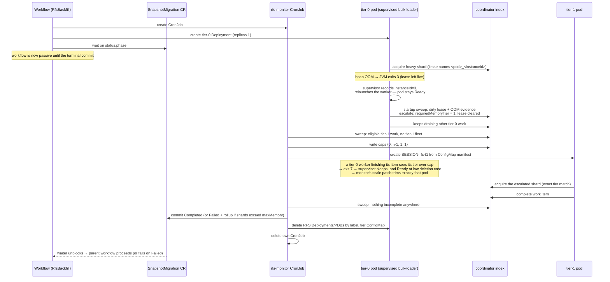

# Design Doc: RFS Crash Escalation and Memory-Tier Scaling

**Status:** implemented

**Date:** 2026-11-19 (implementation 2026-11-20)

## Objective

When an RFS worker is killed by an out-of-memory condition while migrating a shard, escalate
that shard's work item so the current fleet stops retrying it, and run the escalated shard on a
fleet with more memory. Escalation is **eager (greedy)**: as soon as an escalated shard sits
unclaimed at a higher tier, pod budget shifts to run it there while the remaining lower-tier work
continues in parallel — tiers are not sequential passes (lockstep passes were considered and
dropped: they add idle bubbles at every pass tail and chop deep chains across barrier waits for
no pod-hour savings, since every item must be attempted at tiers 0..T anyway). Memory grows
geometrically per tier from a user-configured starting size, by a user-configured factor
(default 2), up to a user-configured maximum. If shards still fail at the maximum, the migration
fails with a report naming which indices completed and which did not.

Secondary objectives shaped the design:

- The RFS image must never inspect its own memory. It receives one opaque integer (its tier) and
  otherwise stays memory-unaware, keeping it eligible to become distroless.
- Non-memory crashes must never climb the memory ladder. A fleet-wide crasher (native bug, poison
  document) at 2×, 4×, 8× memory would multiply the run's cost for nothing, so a tier bump
  requires positive OOM evidence.
- Crash detection must not depend on winning races against restarts or polling windows. Losing
  evidence to a node crash is acceptable; losing it to timing is not.
- Pod count is the throughput budget. The user's constraint is load on the target cluster, which
  is per-pod and memory-independent, so the fleet-wide cap is a **total pod count across all
  tiers**, and no tier may run more pods than it has work for.

## Background: the pieces this builds on

- **Work coordination.** Work items are docs in `.migrations_working_state_<session>` on the
  coordinator cluster. Fields: `expiration` (epoch seconds, 0 = unclaimed), `leaseHolderId`,
  `completedAt`, `successor_items`, `acquisitionLeaseExponent` / `nextAcquisitionLeaseExponent`,
  `scriptVersion`, `creatorId`, `committed_metrics`. Acquisition is a server-side atomic
  `_update_by_query` over "expired and not completed" with a painless script that stamps the
  lease (`OpenSearchWorkCoordinator`).
- **Worker identity.** `workerId = <podName>_<fresh-UUID-per-JVM>` (`ProcessHelpers`). The pod
  name is stable across container restarts; the UUID is unique per process. Both halves are
  load-bearing here (§ "Dirty-lease sweep") — do not make the id stable per pod: it would break
  `getAssignedWorkItemUnsafe`'s exactly-one-lease-per-holder assumption and make a predecessor's
  lease indistinguishable from the current process's.
- **Fleet runtime.** The production path (`fullMigration.ts` → `setupAndRunBulkLoad`) creates one
  RFS `Deployment` via an Argo resource template and waits on the `SnapshotMigration` CR. A
  per-minute monitor CronJob ([rfsCronJobMonitor.md](rfsCronJobMonitor.md)) polls
  `console backfill status --deep-check`, commits CR status, and tears down the runtime at
  completion. It runs as `argo-workflow-executor`, which already holds pod read and deployment
  create/patch/delete RBAC.
- **OOM behavior today.** The JVM runs with `-XX:MaxRAMPercentage=80.0 -XX:+ExitOnOutOfMemoryError`.
  Heap OOM exits the JVM with code **3** (verified empirically), which collides with
  `NO_WORK_LEFT_EXIT_CODE = 3`. A cgroup kill surfaces as `OOMKilled`/137. Either way the
  container dies, kubelet restarts it in place (Deployments mandate `restartPolicy: Always`),
  the dead process's lease sits until expiry, and the shard is retried with a doubled lease —
  memory never grows, so a too-big shard OOM-loops forever. `MaxRAMPercentage` means heap scales
  automatically with the container memory limit; no per-tier JVM args are needed (the existing
  schema warning against setting `-Xmx` in `jvmArgs` applies).
- **Console deep-check.** Classifies shards purely by `completedAt` + `expiration`
  (`backfill_rfs.py`); completion is `completed >= total`. It never reads `leaseHolderId`, but
  any item that is incomplete yet ineligible would today be miscounted as `shard_waiting` —
  hence the status changes in § "Console and CR status".

## Design overview

| Role | Component | Responsibility |
| --- | --- | --- |
| Supervisor + crash recorder | in-container wrapper script (PID 1 of each RFS container) | relaunch the worker in place (pod stays Ready through recovery); record *why* each launch died |
| Kernel-OOM witness | monitor (same sweep) | record the one death the supervisor cannot (cgroup group kill), via a pod annotation |
| Detector + marker | RFS java, startup sweep | find *that* a predecessor died holding work; escalate or recover the item |
| Work router | RFS java, acquire protocol | exact-tier matching + yield to higher tiers |
| Scheduler | monitor CronJob | per-sweep fleet sizing, tier activation/reactivation, budget arbitration, terminal status |
| Policy author | Argo workflow / config processor | render the per-tier manifests and the tier table once, up front |

A shard that OOMs flows through the system like this:

1. Worker holding item `I` at tier `n` dies of memory: heap/metaspace OOM or a library-raised
   `OutOfMemoryError` → exit 3 (a bare 137 such as `kill -9` is NOT OOM evidence). Its lease on
   `I` survives — hard kills bypass shutdown hooks, and that is the evidence.
2. The supervisor records `<instanceId>=3` and relaunches the worker immediately; the container
   never exits, so the pod never leaves Ready. (For the rare kernel OOM that kills the whole
   container, the monitor records `<instanceId>=OOMKilled` on the pod instead and the restarted
   supervisor waits bounded for that evidence — see "Kernel-OOM witness".)
3. The new worker's startup sweep finds the dirty lease (pod-name prefix, different instance id),
   looks its holder up in the predecessor crashes, sees OOM, and executes the
   escalate: `requiredMemoryTier = max(current, n+1)`, lease cleared, lease exponent restored.
4. The same process (and the rest of the tier-`n` fleet) keeps draining other tier-`n` work.
   Workers that find no eligible work at their tier exit with distinct non-zero codes; the
   supervisor sleeps briefly and retries, with the pod Ready and cheap to delete.
5. The monitor's next sweep sees eligible work at tier `n+1` with no fleet, creates (or scales)
   `<session>-rfs-t<n+1>` from the pre-rendered manifest, and trims idle lower-tier pods to fund
   it — never touching a pod that holds a lease.
6. When every item is complete, the monitor commits `Completed` as today. If the only incomplete
   items require a tier beyond the configured maximum and nothing is in progress, it commits
   `Failed` with a per-index rollup.

## Work-item schema additions

The coordination **`scriptVersion` bumps 3.1 → 3.2**. The version exists to outright reject
old clients: every script throws on a document at any other version, so a client from a
different deployment can never operate on this session's documents. Upgrading a live migration
is not supported.

| Field | Written by | Meaning |
| --- | --- | --- |
| `requiredMemoryTier` (int, absent ⇒ 0) | escalation script | minimum fleet tier that may acquire this item |
| `leaseAcquiredAt` (epoch seconds) | acquire scripts | when the current lease was taken (diagnostics; crash attribution itself is by the holder's instance id, not time) |
| `leaseAbandoned` (bool, absent ⇒ false) | deliberate-abandon path | lease was left to expire on purpose; the sweep must not treat it as a crash. **Cleared atomically by the next acquisition** (and by the escalation/release scripts) — a sticky flag would permanently mask later hard crashes on the same item |

Successor items inherit the predecessor's `requiredMemoryTier` (the worker creating them passes
its own tier through).

## RFS worker changes

### New arguments

The tier arrives via the existing `RFS_` env-var injection, set on the Deployment pod template;
the per-launch arguments are passed on the command line by the in-container supervisor
(`runJavaWithClasspathWithRepeat.sh`), which relaunches the worker JVM in place:

```
--worker-memory-tier <int>        RFS_WORKER_MEMORY_TIER   default 0 (env; also switches the
                                                           wrapper into its supervised loop)
--worker-instance-id <id>         per launch, from the supervisor: <containerStartEpoch>-<launchN>.
                                  The worker id becomes <podName>_<instanceId>, so every lease
                                  names exactly the launch that held it.
--predecessor-crashes <id>=<outcome>[,...]
                                  how recent launches in this container died (exit code, or
                                  "OOMKilled"); the startup sweep's evidence. Absent → every
                                  dirty lease is release-only.
--sweep-only                      run the startup sweep and exit 0 (the supervisor uses this on
                                  SIGTERM when a crash has not been swept yet)
```

### Exit codes

| Condition | Code | Supervisor policy (feature on) |
| --- | --- | --- |
| work item completed | 0 | relaunch now (`completedAt` stamped — never again acquirable) |
| unhandled error (uncaught exception) | 1 | record crash, relaunch (backoff after repeated short-lived crashes) |
| lease timeout (successors created) | 2 | relaunch now |
| out of memory | 3 | record as OOM, relaunch now. Heap/metaspace via `-XX:+ExitOnOutOfMemoryError`; an `OutOfMemoryError` raised from library code (e.g. the direct-buffer limit) reaches the same exit through the fatal-error policy (`FatalErrors`: uncaught handler, `Hooks.onErrorDropped`, and the HTTP/retry boundaries — reactive failures travel the onError channel, where a retry operator would otherwise swallow them) |
| work exists, none eligible for me | 4 | sleep 15–30 s, relaunch |
| non-retriable snapshot read failure | 5 | record crash, relaunch (pre-existing code; aligned with the metadata command) |
| no work left anywhere (drained) | 6 | sleep 60–90 s, relaunch. **Was 3** — renumbered to free 3 for OOM |
| own tier over its lease cap | 7 | sleep 15–30 s, relaunch. The pod stays Ready while it idles; the monitor's pod-deletion-cost, not readiness, marks it as the scale-down victim |
| non-OOM `java.lang.Error` (LinkageError, AssertionError, …) | 8 (new) | record crash, relaunch. Fail-fast like an OOM, but the sweep must *release*, never escalate — a deterministic non-memory crash must not climb the memory ladder |
| SIGKILL of the worker | 137 | ambiguous alone; recorded as OOM only when the container cgroup's `oom_kill` counter rose (the non-k8s witness). Under cgroup v2's default `memory.oom.group=1` a kernel OOM kills the supervisor too — see "Kernel-OOM witness" |

Nothing outside the container consumes the old codes, so renumbering is contract-internal.
With the feature off (`RFS_WORKER_MEMORY_TIER` unset) the wrapper keeps its original behavior:
relaunch on 0, exit otherwise, kubelet restarts the container.

### Dirty-lease sweep (startup, before any acquisition)

```
dirty = search( prefix(leaseHolderId, podName + "_")
                AND leaseHolderId != myWorkerId
                AND NOT exists(completedAt)
                AND expiration > now
                AND NOT leaseAbandoned )
for each dirty lease:
    outcome = predecessorCrashes[ instanceIdOf(lease.leaseHolderId) ]   # exact, no timestamps
    if outcome is "3" or "OOMKilled":
        escalate: requiredMemoryTier = max(current, myTier + 1)
                    nextAcquisitionLeaseExponent = acquisitionLeaseExponent   # tier ≠ time
                    expiration = 0; leaseHolderId = null
    else (any other outcome, or holder not in the list):
        release only (same fields cleared, tier untouched)
```

Properties:

- **Race-free trigger.** Every benign exit path (completion, successor creation, timeout, SIGTERM
  hook, uncaught exception — a normal JVM exit runs shutdown hooks) destroys or transfers its
  lease first. Only hard kills (heap OOM bypasses hooks via `os::_exit`, cgroup SIGKILL, JVM
  native crash) leave a live lease behind. First starts and clean restarts find nothing.
- **Exact attribution.** The lease names its holder as `<podName>_<instanceId>` and the
  supervisor reports crashes by the same instance id, so classification is a map lookup — no
  clock comparison, no skew window, no polling, and no way to attach a verdict to the wrong
  lease.
- **Conservative default.** No OOM evidence → no tier bump. A real OOM recurs and gets attributed
  on a later round; a transient crash just gets its lease back immediately (an improvement over
  today's wait-for-expiry, and deliberately kept even though crashes are rare).
- **Idempotent.** The escalation script guards on the observed `leaseHolderId` and no-ops if the
  lease moved; clearing the lease means a second look finds nothing.
- The `leaseHolderId != myWorkerId` clause is an invariant, not a live filter: the sweep runs
  before any acquisition and the instance id is minted per launch, so it can never match today.
  It keeps the sweep safe against its own live lease if it is ever re-run mid-process (the
  planned in-java acquire loop would do exactly that).
- **SIGTERM cover.** The worker's shutdown hook finishes a startup sweep that had not completed,
  and if SIGTERM lands between a crash and the next launch, the supervisor runs one `--sweep-only`
  worker before exiting — so recorded evidence is never lost to a scale-down.
- The escalation update is a painless scripted `_update` like every other coordinator mutation —
  version conflicts surface as 409s and retry, consistent with the existing client.
- The deliberate-abandon path (failed-document-stream flush failure at shutdown,
  `RfsMigrateDocuments.flushFailedDocumentStreamBeforeComplete`) runs live pre-exit code; it
  gains one write setting `leaseAbandoned: true` so the sweep skips it.

### Acquire protocol: exact tier + yield

Exact-tier matching keeps 7 GB work off 256 GB pods. The yield rule exists because pods re-employ
themselves at acquire time faster than any monitor sweep: without it, a saturated lower tier never
frees budget for a higher one. Yield is evaluated on **every acquisition attempt**, so it covers
both "same container grabs the next shard" and "fresh pod appears inside the sweep window".

The **published caps** are how the monitor talks to the workers: a `maxLeases: {tier: cap}`
field that the monitor rewrites each sweep on the `shard_setup` sentinel work item (which every
status/work query already excludes, so the caps need no document or index of their own) and that
every worker reads at each acquisition attempt. A missing sentinel, field, or tier entry means
"no cap". Details under "Declarative per-tier lease caps" below.

An acquire attempt is up to three cluster requests; everything between them — including the
decision itself — runs in the worker:

```
each acquire attempt:

  request 1 — CENSUS: one _search, counting done cluster-side, no documents returned.
      Matches every incomplete item (has expiration, no completedAt) and asks the cluster to
      group them by requiredMemoryTier and return a count per group (a "terms aggregation" —
      OpenSearch's GROUP BY ... COUNT(*); "missing": 0 counts items without the field as
      tier 0). Nested inside each group, a filter sub-aggregation also counts how many of that
      group are WAITING (expiration < now, i.e. unclaimed).
      The worker then computes, for its own tier only:
          leased[myTier] = group total − waiting[myTier]        (the "split" — subtraction,
                                                                 done in the worker)
      and reads totalIncomplete from the response's overall hit count.

  request 2 — CAPS: one GET of the shard_setup document (skipped if request 1 says drained).
      shard_setup is the session-wide setup-gate sentinel: exactly ONE document per migration
      session (fixed id "shard_setup" in .migrations_working_state_<session>), shared by all
      tiers. The monitor writes the whole caps map onto it (maxLeases: {"0": 21, "1": 2, ...});
      every worker GETs this same document and picks out maxLeases[myTier]; absent ⇒ no cap.

  decision — worker-local, a pure function over the two responses:
      totalIncomplete == 0                         → exit 6  NO_WORK_LEFT (drained)
      leased[myTier] >= cap[myTier]                → exit 7  OVER_CAP (idle; monitor reclaims)
      waiting[myTier] > 0                          → proceed to request 3
      else (exists, but other-tier or all leased)  → exit 4  NO_WORK_AVAILABLE

  request 3 — ACQUIRE: the atomic _update_by_query scoped to my tier (random_score retained),
      followed by the pre-existing _search that fetches the item just won.
```

- **Tier-0 matching must treat a missing field as tier 0.** A `term requiredMemoryTier == 0`
  clause matches nothing on docs that never gained the field (all initially-created items), which
  would make the entire initial workload unacquirable. Tier-0 workers acquire with
  `should: [term requiredMemoryTier == 0, must_not exists requiredMemoryTier]`; tiers > 0 use the
  plain term clause; every agg over the field sets `"missing": 0`.
- **Declarative per-tier lease caps.** The monitor publishes **state, not orders**: a
  `maxLeases: {tier: cap}` field on the `shard_setup` sentinel (already excluded from every
  status/work query, so the caps need no document or index of their own), rewritten each sweep.
  The caps *are* the allocation (`Σ caps ≤ maxTotalPods`, assigned per the precedence rules
  below). The mechanism's properties:
  - **No herding.** A worker idles only when its **own tier's** live-lease count meets its own
    cap — never because work exists at another tier — so one escalated shard can never idle the
    rest of the fleet.
  - **Preemption-free reclamation.** Lowering `cap[0]` from 24 to 21 drains exactly the excess
    as workers hit item boundaries (the only preemption-free moment), never mid-shard.
  - **Stale-safe without TTLs.** Caps are read-only for workers and are not orders that must
    expire: a dead monitor leaves at worst a tier running slightly under capacity until the
    next sweep rewrites them.
  - **Approximate, self-correcting convergence.** Two workers racing at `cap − 1` can both
    acquire; the next finisher at that tier sees over-cap and idles.
- The agg pre-check + scoped acquire replaces any fetch-then-reject shape: acquisition is a
  server-side atomic update, so "inspecting" an item would already have leased it.
- **Cost:** the precheck adds one terms-agg search plus one sentinel GET per acquisition
  attempt, against a coordination index of at most a few thousand small documents — negligible
  next to the `_update_by_query` + follow-up search the acquisition already performs. It runs on
  every attempt by design (yield must be re-evaluated at each item boundary).
- **Why the yield decision can't live inside the atomic acquire itself.** The painless script in
  `_update_by_query` evaluates one document with only `ctx._source` in scope — no aggregations,
  no sibling lookups — so per-document predicates (the tier match) belong in the query, but both
  fleet-level questions ("does a higher tier have waiting work?", "how many live leases does my
  tier hold vs. its cap?") are cross-document and unanswerable there. A sort-tier-descending +
  noop-on-mismatch shape would also hinge on under-specified `_update_by_query` sort/noop/max_docs
  semantics across ES 6.8 and OS 1–3 — and if it worked, it would make every lower-tier worker
  yield whenever any higher tier had waiting work, letting one escalated shard idle the entire
  fleet. The cap check deliberately needs no atomicity (see convergence note above); only the
  lease write does, and it has it.
- Races are benign because nothing preempts: a worker that grabs one last item just as an
  escalation lands above it simply finishes that shard and yields on its next attempt.
- Why higher tiers are funded first: a shard that split N times is a sequential chain of work
  items that only one pod at a time can advance, so its remaining length is irreducible
  wall-clock — and the migration finishes only when the longest such chain does. Higher tiers
  hold exactly those chains, the allocation precedence funds them first, and the never-preempt
  floor (§ below) keeps each chain's one pod running continuously.

Moving the acquire loop fully into java (replacing the `runJavaWithClasspathWithRepeat.sh`
exit-0 restart loop) is the companion change that removes the image's last shell dependency for
distroless; with it, yield becomes an in-process capped sleep instead of an exit code. It is not
required for this feature.

## In-container supervisor

`runJavaWithClasspathWithRepeat.sh` (PID 1 of the bulk-loader container) becomes a supervisor
when `RFS_WORKER_MEMORY_TIER` is set: it relaunches the worker JVM in place per the exit-code
policy table above and **never exits on its own**, so the container keeps running and the pod
stays Ready while a worker recovers from a crash. That is the load-bearing property: a
ReplicaSet scale-down ranks victims by readiness *before* pod-deletion-cost, so a pod that
flipped not-ready at the instant of an OOM would be culled mid-recovery regardless of the
monitor's annotations. Keeping the pod Ready lets the monitor protect a recovering lease holder
by assigning it a high deletion cost.

Per launch, the supervisor mints `--worker-instance-id <containerStartEpoch>-<launchN>` and
passes the recent crashes as `--predecessor-crashes` (last 5, `<instanceId>=<exit code or
OOMKilled>`), giving the sweep its exact-attribution evidence. The worker's own memory flags are
untouched: heap stays at `MaxRAMPercentage=80`, and no metaspace/direct caps are imposed —
artificially low caps could force a shard to climb several tiers to satisfy a limit it never
actually needed, so the design prefers an occasional kernel OOM (witnessed below) over
miscategorized escalations.

Two optional environment hooks, both plain files so the script stays environment-agnostic:

- `RFS_STATE_DIR` — a directory that outlives the supervisor but not the pod (an `emptyDir` in
  k8s). Holds the crash list and an **open-launch ledger** entry written before each launch and
  closed with its outcome; an open entry at supervisor startup means the whole container died
  abruptly (the kernel-OOM case).
- `RFS_CRASH_EVIDENCE_FILE` — a file an outside witness maintains with the same
  `<instanceId>=<outcome>` entries, merged into the crash list before every launch.

### Kernel-OOM witness (the monitor)

Under cgroup v2's default `memory.oom.group=1` (k8s ≥1.28 behavior, verified empirically), a
kernel OOM kills **every** process in the container — supervisor included — so no in-container
code can record it; the kubelet restarts the container and the evidence would die with it. The
witness is the component that already watches the fleet:

1. The monitor's pod LIST (which it already performs each sweep) carries
   `lastState.terminated.reason == OOMKilled` with the dead container's `startedAt`/`finishedAt`.
2. Instance ids begin with the container-start epoch, so the dead holder is simply the dirty
   lease on that pod whose instance timestamp falls inside the dead container's lifetime
   (± small skew; same node clock). No tick-over-tick holder tracking.
3. The monitor patches one pod annotation,
   `migrations.opensearch.org/rfs-predecessor-crashes: <instanceId>=OOMKilled` (merged,
   length-capped, idempotent — one small PATCH per actual kernel OOM).
4. A downward-API volume projects that annotation into the container as the
   `RFS_CRASH_EVIDENCE_FILE`; the kubelet rewrites the file in place when the annotation changes.
5. The restarted supervisor finds the open ledger entry with no outcome and **waits bounded**
   (`RFS_EVIDENCE_WAIT_SECONDS`, default 120 s — one monitor tick plus downward-API propagation)
   for the file to name that instance before launching, so the first post-OOM sweep escalates
   instead of releasing blind. The wait ends early the moment the evidence appears; if it never
   does (e.g. the container was SIGKILLed by something other than the kernel, where no OOMKilled
   record exists), launching with no evidence is the correct outcome — release at the same tier.

The monitor **still never mutates work items**: there is exactly one writer path for coordinator
mutations (a worker's startup sweep, in the battle-tested java client). The monitor only
annotates pods, which it already does for deletion costs. Degradation is safe in both directions:
monitor down → kernel-OOM items retry at the same tier with growing restart backoff until it
returns (JVM-raised OOMs — the dominant path, since heap is 80 % of the budget — never involve
the monitor); evidence late → one same-tier retry, self-correcting because restart backoff grows
past the witness latency.

Outside k8s (docker/local), there is no monitor: the supervisor's cgroup `oom_kill`-counter check
on a 137 is the kernel-OOM witness there (single-process kills; without `oom.group` the wrapper
survives).

**Rejected alternatives.** A per-pod sidecar witness (an earlier draft of this design) writes the
same evidence with lower latency, but costs an extra container on every one of hundreds of worker
pods, its own RBAC and image pulls, and still cannot keep the pod Ready through a worker crash —
the supervisor was needed anyway, at which point the fleet-wide monitor covers the rare kernel-OOM
case for free. Lowering the supervisor's `oom_score_adj` to −1000 (so it survives the group kill
and records the evidence itself) works — verified with `CAP_SYS_RESOURCE` granted — but the
capability is outside the Pod Security "baseline" profile and protecting a process from the OOM
killer in a memory-stressed container was judged imprudent; it remains possible as a purely
optional hardening since the write degrades gracefully to a no-op without the capability.

## Fleet management

### One Deployment per tier

A Deployment has one pod template and tiers differ in `resources.memory` and
`RFS_WORKER_MEMORY_TIER`, so each tier gets its own Deployment `<session>-rfs-t<n>` (plus PDB).
The tier label must appear in the **immutable `spec.selector`**, the pod-template labels, and
each PDB's selector — not just on metadata. Today's selector is component + migration UID only
(`workloadSelectorLabels`); copying that shape across tier Deployments would give multiple
controllers overlapping selectors, which Kubernetes explicitly warns causes them to fight over
each other's pods. The monitor and console must select RFS runtime objects by **label, not fixed
name** (today's single `RFS_DEPLOYMENT_NAME` plumbing in the monitor teardown and the console's
worker-count lookup changes to label selectors; component + UID without tier selects the whole
set, adding the tier label selects one fleet).

### Budget and allocation (monitor, every sweep)

`maxTotalPods` is the fleet-wide cap, pod-count-denominated because per-pod throughput to the
target is memory-independent. There is no native k8s construct for "max pods across a set of
Deployments" (annotation-counted quotas do not exist; `ResourceQuota` is namespace-wide, blunt,
and priority-blind — usable only as an optional defense-in-depth backstop), so the monitor's
arithmetic is the mechanism — and it must exist anyway to express priority:

```
per sweep:
  busy[t]     = DISTINCT RUNNING pods of tier t named in live leases (a lease whose holder pod
                is gone or terminating is a GHOST. It still occupies a lease slot, so it is
                added to the tier's published cap and subtracted from its demand)
  eligible[t] = incomplete items at tier t
  precedence (highest wins when the budget cannot satisfy all three):
    1. busy floor: never set replicas[t] below busy[t] — inviolable
    2. higher-tier demand, tier-descending: each tier gets min(eligible[t], remaining budget)
    3. discovery floor: >= 1 pod for the lowest tier with never-attempted items, funded only
       from budget left after (2) — greedy wins over discovery when they conflict
       (deep chains are revealed by attempts, so keep discovery alive whenever budget allows)
  publish: write the resulting per-tier allocation as maxLeases caps on the shard_setup sentinel
           (see acquire protocol); pods owed to higher tiers drain from lower ones as workers
           hit item boundaries and find their tier over-cap — never by deleting a busy pod
  trim: for over-allocated tiers, annotate idle pods (replicas - busy) with low
        controller.kubernetes.io/pod-deletion-cost, busy pods with high, then
        patch replicas = busy + kept-idle — in that order, same sweep
  reactivate: eligible work at a tier with no fleet → create its Deployment from the
              pre-rendered manifest (replicas = min(eligible, available budget))
  bootstrap: level 0 starts at the FULL pod budget (maxTotalPods) — workers self-coordinate
             through the coordination index as they always have, and node provisioning overlaps
             shard setup instead of trailing the first sweep. Until the shard_setup sentinel
             completes the monitor LAYS OFF entirely (no caps, no trims, no creates): item
             counts are meaningless before work items exist, and acting on them would cull the
             fleet mid-setup. The first post-setup sweep right-sizes to min(eligible, budget).
  metrics: each sweep emits its per-tier truth (cap, desired replicas, busy, ghosts, eligible,
           waiting) as fleetMonitor-scope gauges through the OTel collector for scheduler investigations
```

Rebalancing is **attrition-based**: budget moves to higher tiers only as lower-tier pods actually
go idle (which the lowered cap guarantees as each worker reaches its next item boundary).
If a tier has no idle pods, the monitor waits — it never deletes a lease-holding pod.

### Culling the right pod

ReplicaSet downscale victim ranking: unscheduled → pending → **not-ready** → **lower
pod-deletion-cost** → shorter ready time → more restarts → newer. There is no pluggable policy
hook. Because the in-container supervisor keeps every pod Ready — through crashes, OOM recovery,
and idle sleeps alike — the not-ready rung never differentiates RFS pods, and victim selection
rests on `pod-deletion-cost`:

1. The monitor sets `pod-deletion-cost` from lease truth (busy high, idle low, only values that
   changed) immediately before each scale patch, with a short pause so the ReplicaSet's cache
   sees the costs before choosing victims.
2. An idle (over-cap / no-work) worker is a sleeping supervisor, not a crash-looping container —
   its pod stays Ready with a low deletion cost, so it is exactly the pod a scale-down takes.

Residual race: a pod judged idle grabs work in the instant before deletion → SIGTERM → existing
clean-shutdown hook checkpoints or releases → cost ≈ one lease round-trip. The inverse
(undercounted idle) delays rebalance by one sweep. PDBs do not protect against scale-down
(it is not an eviction), crashloop restarts alone never remove a pod, and no min/max field exists
on Deployments — the monitor's floor rule is the only guard, by design.

`pod-deletion-cost` is a documented *preference*, not a contract — the design must stay correct
if the ReplicaSet deletes a busy pod anyway. It does, by degradation: SIGTERM → clean shutdown
checkpoints/releases (fine); if shutdown overruns and is force-killed, the pod never restarts (it
was deleted, so no same-pod sweep runs) and the lease expires naturally — the pre-existing safety
net; one delayed retry, no lost work. To make the overrun rare, RFS pods set
`terminationGracePeriodSeconds` comfortably above the shutdown path's worst case (failed-document
flush is bounded at 5 min, so e.g. 390 s), and the wrapper's internal 30 s SIGKILL fallback rises
to match.

Known lag: a yielded pod the monitor keeps re-checks at the supervisor's idle cadence (15–30 s
sleeps for over-cap/no-work, 60–90 s when the queue looks drained), so lower-tier resumption
after a higher tier claims its items can trail by under a minute. Acceptable at sweep
granularity; the in-java acquire loop removes it later.

## Orchestration

- **Workflow = policy author.** At setup it publishes the complete per-tier Deployment manifests
  into a ConfigMap, alongside `maxTotalPods`. The manifests are
  **derived, not re-rendered**: `renderRfsTierPolicy.sh` reads the LIVE tier-0 Deployment + PDB
  and transforms them per tier (`deriveRfsTierManifest.jq`: name, tier label in
  selector/labels, the precomputed memory quantity, tier env, replicas 0), so the stored
  manifests can never drift from the shape that actually runs. The tier table is **precomputed
  in the TypeScript config processor** (`resolveMemoryScalingTierTable`) —
  `[start, start×f, start×f², …, max]` (last entry clamped to exactly
  `maxMemory`) — so neither Argo expressions nor bash ever do quantity arithmetic. The workflow
  then proceeds exactly as today: apply monitor CronJob, create the tier-0 runtime, wait on the
  CR, tear down. No per-tier workflow steps, no recursion: tier lifecycle is continuous
  reconciliation and lives in the monitor.
- **Monitor = scheduler.** The sweep logic above, plus terminal status:
  - all items complete → `Completed` / `CompletedWithErrors` exactly as today (failed-document
    stream still decides the latter; see [failedDocumentStream.md](failedDocumentStream.md));
  - incomplete items exist, all have `requiredMemoryTier` > max tier, nothing in progress →
    `Failed`, with the per-index rollup (below) in the CR status/message. The classification is
    computed by the console deep check (the existing classifier role); the monitor commits the
    phase. **`Failed` must join
    the terminal set everywhere** or the parent workflow hangs: the monitor's
    completion check (`rfsMonitorCronJob.sh`, which today loops on anything other than
    `Completed`/`CompletedWithErrors`) treats it as terminal and runs the same
    commit-and-teardown path, and `waitIndefinitelyForSnapshotMigration`
    (`resourceManagement.ts`) recognizes it and fails the waiting workflow step so the failure
    propagates instead of waiting forever.
- **No manual approvals, by design.** Escalation never waits on a human: once the user has
  stated the acceptable range (`maxMemory`, `maxTotalPods`), asking again per tier is a wasted
  interaction, and worst-case spend is already bounded by `maxTotalPods × maxMemory`. Aggregate
  cost control belongs to **nodepool constraints** (Karpenter/EKS Auto Mode instance-type and
  capacity limits): they throttle how much actually schedules, can be changed out from under a
  running migration, and are therefore easily reversible — escalated pods just sit `Pending`
  (visible as `workers.pending` in status) until capacity is allowed. Spend *rate* tracks fleet
  composition, a continuous quantity watched by alarms on the per-tier fleet panels ("Metrics
  and dashboards"), not gated at first instance. The distribution-shaped concern (most of the
  workload escalating — a leak rather than fat shards) is the escalation-storm guard in Future
  work.

### How the workflow, the CronJob, and the tier Deployments relate

The workflow touches the RFS Deployments exactly once — it creates tier 0 at setup. From then on
the monitor CronJob is the only thing that creates, scales, or deletes RFS Deployments; the
workflow just waits on the SnapshotMigration CR, which the monitor eventually drives to a
terminal phase. Every runtime object carries an ownerReference to the SnapshotMigration CR.

Every tier shares one Deployment shape, defined once: the workflow's template renders tier 0,
and `renderTierPolicy` derives the tier-1..N manifests *from the live tier-0 object* (rename,
tier label, memory quantity, replicas 0) into the ConfigMap. So the two "create" arrows below
are the same manifest with two instantiators — the workflow stamps out tier 0 at setup; the
monitor stamps out any higher tier from the ConfigMap the moment that tier first has work.


And one shard's escalation over time — note the workflow never reappears between setup and the
terminal commit; the loop runs entirely between the pods, the coordinator, and the monitor:



### User configuration (`documentBackfillConfig`)

```yaml
resources: { requests: { memory: 7000Mi, ... } }   # starting size (existing field)
memoryScaling:                                     # NEW; absent ⇒ feature entirely off
  growthFactor: 2            # expert, default 2
  maxMemory: "56000Mi"       # required; caps the tier table
maxTotalPods: 24             # replaces podReplicas semantics when memoryScaling is set:
                             # a TOTAL across all tiers, and a maximum, not a constant
```

Constraints and operational notes:

- `growthFactor` has a schema floor of **1.1** (not merely > 1), so a pathological factor cannot
  create thousands of tiers.
- `maxTotalPods` defaults to `podReplicas` when `memoryScaling` is set without it (one knob for
  the common case); `maxTotalPods` without `memoryScaling` is a validation error.
- `console backfill scale` is **not supported** while `memoryScaling` is on: the monitor rewrites
  per-tier replicas every sweep from `maxTotalPods`, so a direct replica patch would be
  overwritten within a minute. The supported knob is the `maxTotalPods` config value.

Each tier's manifest sets `requests.memory` **and** `limits.memory` to the same tier value
(preserving Guaranteed QoS, matching today's defaults where requests == limits); the schema
permits unequal values in general, but this feature locks them — heap sizing follows the limit
while scheduling follows the request, and letting them diverge per tier would make "the tier's
memory" ambiguous. CPU carries over unchanged from the base `resources`.

With `memoryScaling` absent, nothing changes: one deployment, today's names, today's status JSON
byte-for-byte, no acquire-query additions exercised (absent `requiredMemoryTier` matches no
range/term clause). Scope is the k8s/Argo path; the ECS path is untouched.

## Console and CR status

New fields appear **only when `memoryScaling` is configured**:

- `shard_awaiting_memory` — incomplete items whose tier exceeds every active fleet's tier.
  `shard_waiting` keeps its exact current meaning (eligible-and-unclaimed), so existing
  consumers' semantics hold and `total = complete + in_progress + waiting + awaiting_memory`.
- `workers: {desired, running, pending}` per the deployment set — surfaced so "escalated but pods
  unschedulable" (no node fits the new size; Karpenter/EKS Auto Mode usually self-heals) is
  distinguishable from "running".
- `memory_scaling: {tiers: [...], active: [{tier, replicas, busy}], ...}` for observability.
- Terminal `Failed` carries the rollup, aggregated per index (work items for successors need the
  plaintext `indexName` field added at creation, or the console decodes the base64url `_id`):

```json
{
  "status": "Failed",
  "message": "3 shards still exceed maxMemory (56000Mi) at tier 3",
  "indices": {
    "succeeded": ["logs-2024-01", "logs-2024-03", "orders"],
    "incomplete": [
      {"index": "logs-2024-02", "shards_complete": 14, "shards_total": 16,
       "shards_exceeding_max_memory": [3, 7]}
    ]
  }
}
```

## Metrics and dashboards

### What the fleet used

Read CPU and memory alongside documents migrated per second. Each colored band shows one tier's
CPU consumption in cores or sampled container working set in GiB. The gray band shows the portion
of running containers’ limits above measured usage. It includes the full limit of any worker whose
usage reading is missing. A worker measured above its own limit contributes zero to the gray band
and its full measured usage to its tier. A pending worker starts contributing once its bulk-loader
container runs. Workers from different migrations can have different limits at the same
tier, so each running worker contributes its own configured limit. Workers without memory scaling
contribute to tier 0.

CPU requests influence placement. EC2 cost depends on which nodes run and for how long. On the
memory chart, a large gray band can coexist with an OOM in one worker. Grafana's hottest-pod
panels compare each running pod with its own limit. Working-set samples can miss a brief peak.
Use the OOM evidence and the shard's `requiredMemoryTier` to investigate an escalation.

On EKS the resource sampler lists running bulk-loader containers every 15 seconds and reads CPU
and working set from the kubelets hosting them. It matches the pod UID, container, and sample time
before summing by tier. CloudWatch plots the mean of each minute’s successful censuses. A worker
observed during one of four censuses contributes one quarter of that observation to the minute.
An empty census contributes zero. During partial coverage the colored bands sum only the workers
with fresh readings. A failed pod list contributes no observation. The sampling panel shows how
many censuses succeeded and how many workers were awaiting each measurement. Resource series begin
at rollout, and new tiers appear when first observed. For a self-managed target, set
`metrics.cloudWatch.showManagedTargetDomain` to `false` to hide the managed-service panels.

### Investigating a move to a higher tier

**Workers by memory tier** shows how many running workers used each tier. It sits next to fleet memory
in **Throughput and worker resources**. A run that stays at its starting size uses only tier 0.

For a run that climbs the ladder, `workItemsEscalated` counts applied moves by destination tier.
One item can move several times. The applied-action logs identify the items and can reconcile counts
when a worker or collector exits before export. The coordination index retains the resulting
`requiredMemoryTier` on each completed item.

For the scheduler's view, inspect the `fleetMonitor` events in the `rfs-tier` stream of the
`/metrics/OpenSearchMigrations` log group. `tierEligibleItems` includes waiting and in-progress items.
Use the latest check per migration and tier in each minute when comparing counts. The sweep log
also records busy workers, lease caps and requested replicas. The workflow records final completion.

### Validating "Culling the right pod"

The decision to trust `pod-deletion-cost` ranking (a preference, not a contract) is checkable
because the monitor already holds both sides of the truth — leases and pods:

- **Busy-cull count — the metric that must stay ~0.** A pod that was in the busy set (named in a
  live lease) and is gone from the pod list one sweep later, without its item completing, was
  culled while working. Derivable today by joining consecutive sweep logs with the ReplicaSet's
  `SuccessfulDelete` events (which distinguish culls from crashes). For a nonzero count, check
  the deletion-cost map in the same sweep's log to see which costs the monitor assigned.
- **Cull cost when it does happen**: for a culled pod's item, the gap between the cull and the
  item's next `leaseAcquiredAt`. Roughly zero means the clean-shutdown hook released the lease
  (the designed degradation — one round-trip); a gap near the remaining lease duration means the
  shutdown overran its 390 s grace and the lease expired naturally — the signal to revisit the
  grace budget.
- **Attrition latency** measures the sweeps from a cap reduction until `replicas == desired` on
  that tier. Compare the sweep logs with the live leases to see which shards held workers busy.

## Testing

- **Unit (java):** sweep classification table (predecessor outcome × escalate/release, including
  bare 137, exit 8, and holder-not-reported); crash-list parsing; fatal-error policy (OOME
  anywhere in a cause chain → 3, other Errors → 8, exceptions pass through); escalation script
  guards and idempotence; acquire protocol decision table (drain / yield / acquire / idle); tier
  inheritance on successors; exit codes.
- **Supervisor (shell, against the real image):** exit-code policy matrix, crash-list trimming
  and per-launch CLI args, ledger persistence across a simulated group kill, bounded evidence
  wait with early exit, sweep-only on SIGTERM, feature-off loop unchanged.
- **Unit (console):** new classification buckets; gating (feature-off output byte-identical);
  terminal rollup aggregation.
- **Templates (jest, orchestrationSpecs):** per-tier manifest rendering (state/evidence volumes,
  no sidecar), tier-table computation and clamping, monitor arithmetic fixtures (allocation,
  ghost leases, deletion costs, kernel-OOM witness matching), feature-off no-op.
- **Integration:** LocalStack/k8s test that migrates a snapshot containing one shard whose
  documents exceed a deliberately tiny tier-0 memory limit; assert the escalation, tier-1 fleet
  creation, completion, and status JSON shape. A second variant with a non-OOM crash (kill -9
  the worker, producing exit 137 without a rise in the cgroup's oom_kill counter — deliberately
  not OOM evidence) asserting *no* tier bump and immediate lease recovery.

## Future work (deliberately out of v1)

- **Within-tier successor preference.** The acquire stays `random_score` within a tier;
  preferring a crashed shard's own successors would shorten chains slightly, but the discovery
  floor plus greedy tier-descending budget already covers chain continuity.
- **Live `maxTotalPods` override.** Today the budget is a config value; surfacing a runtime
  override through the monitor (so `backfill scale` could work again) is future work.
- **In-java acquire loop** (end of "Acquire protocol"): folds the supervisor's relaunch loop into
  the JVM (one process takes item after item) and turns yield into an in-process capped sleep;
  also removes the yielded-pod resumption lag. The shell supervisor must remain for crash
  isolation — a JVM that OOMed cannot be trusted to continue — but would launch far less often.
- **Escalation-storm guard**: alert (or pause further tier activation) when > N% of remaining
  shards escalate within one tier — that pattern smells like a leak, not fat shards.
- **Explicit `busyCulled` sweep log line.** Operators can reconstruct a busy cull from sweep logs
  and Kubernetes deletion events. A dedicated event would make that investigation faster.
